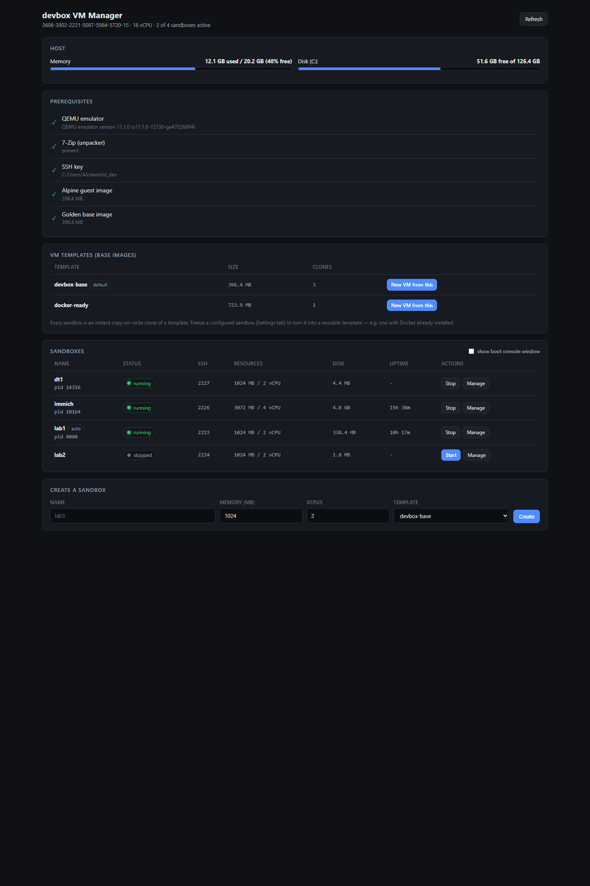
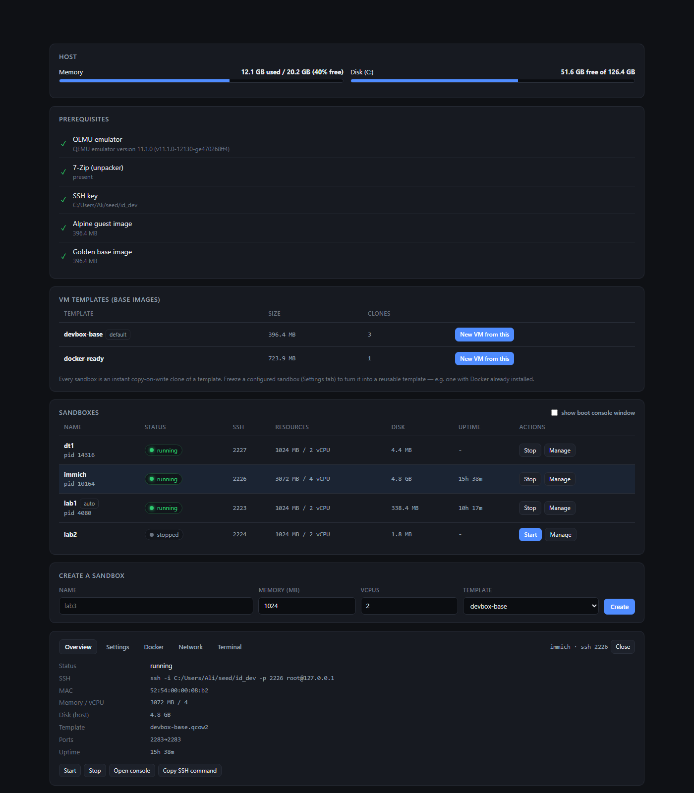
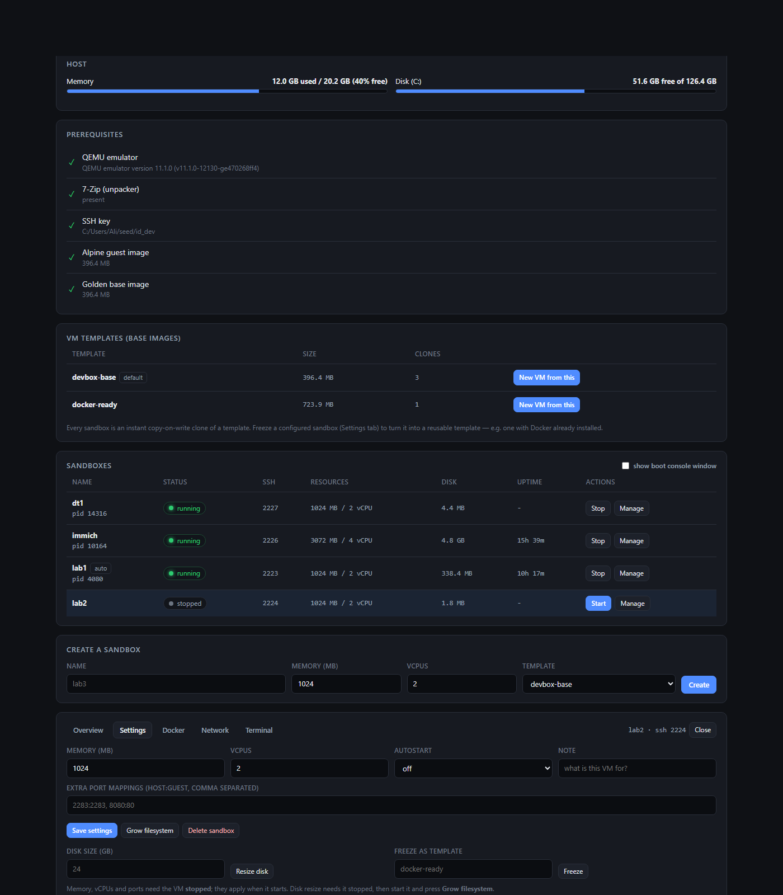
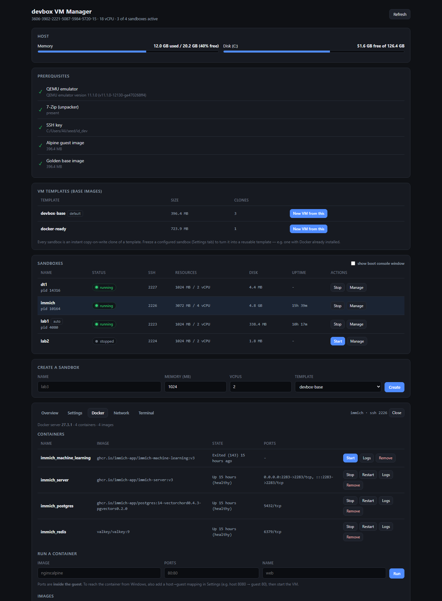
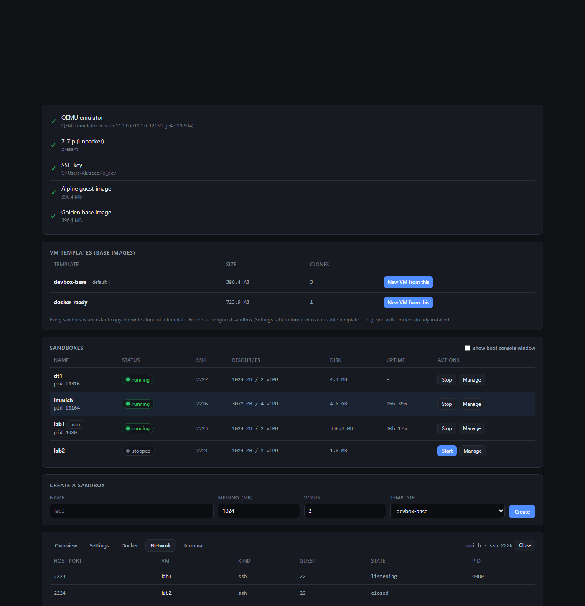
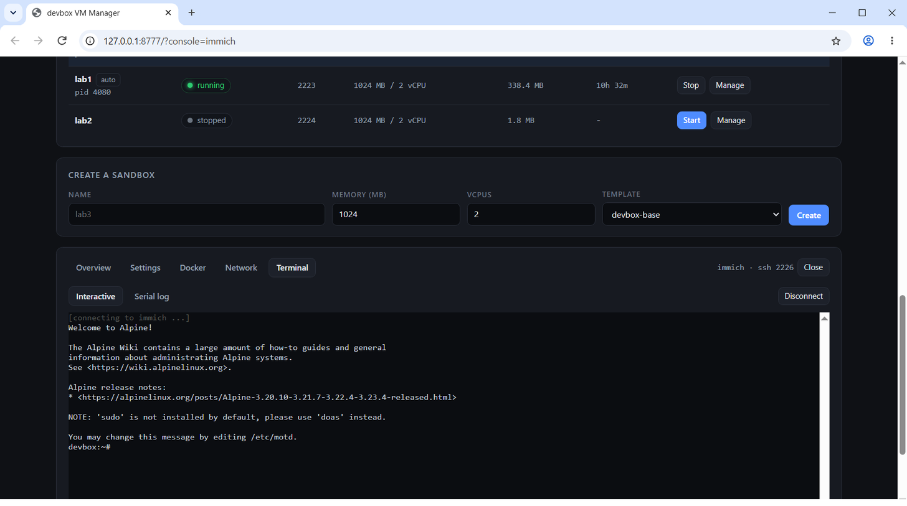
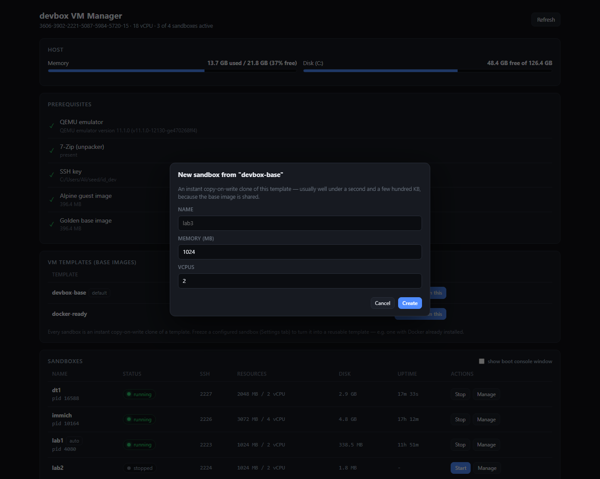
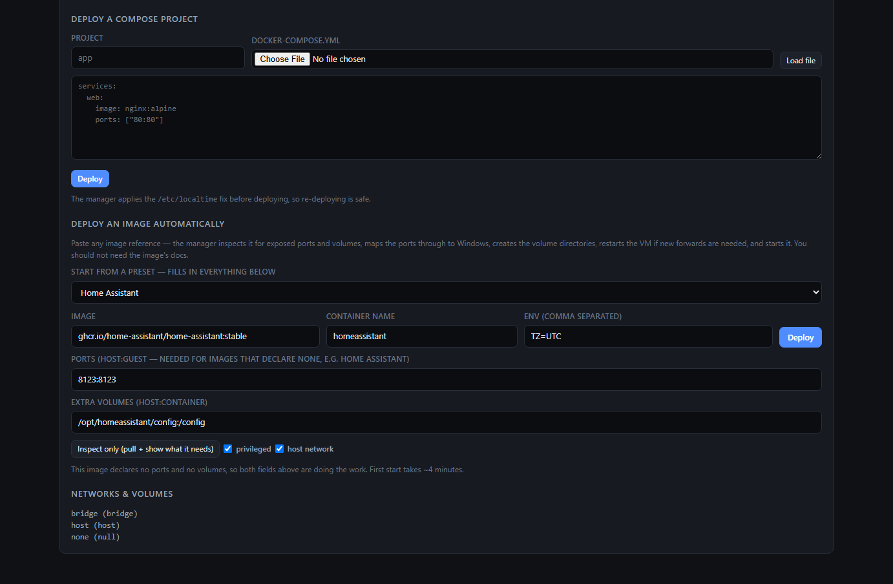

# devbox VM Manager

**Run Docker images on Windows without Docker Desktop, WSL or Hyper-V.**

Type an image reference, or let Claude do it, and the image runs in seconds as
its own lightweight **microVM**. The manager pulls the image straight from its
registry, boots it with a small Linux kernel under QEMU, and hands back its
link, or its output and exit code. No Docker Engine runs anywhere. For compose
stacks and interactive work, the same manager runs **full Alpine Linux VMs**
with Docker inside. Folders of this PC can be **shared live** with both. An
**MCP server** lets Claude create boxes and run images on demand.

- **One image, one microVM, in seconds.** Measured on a Windows 10 PC with a
  cached image: `hello-world` returns its output and exit code 1.5 s after
  the request, and `nginx:alpine` answers HTTP 200 after 1.3 s. A graceful stop
  takes 0.1-0.35 s. The image stays on a shared read-only disk, so a container
  needs about **128 MB of guest RAM whatever the image size**; nginx's QEMU
  uses 170 MB of this PC's memory. The hypervisor isolates each container, one
  VM per image ([details](#running-a-docker-image)).
- **Full Linux VMs with Docker inside**, for compose stacks, privileged
  images and anything the microVM engine cannot run. They are also
  interactive boxes to build and test in: a root terminal in the browser, SSH,
  snapshots and templates. A new VM answers on SSH in 12-14 s
  ([which engine when](#which-engine-to-use)).
- **Live shared folders**: a folder of this PC appears inside a VM or a
  container, both ways, with nothing to install and no copying
  ([details](#shared-folders-live)).
- **Claude integration**: 37 MCP tools. Claude can run images, create VMs,
  run commands in them, move files, share folders and clean up after itself
  ([details](#claude-integration-mcp)).
- **Your ports stay on this PC**: every published port listens on 127.0.0.1
  unless you switch that one port to "reachable from the LAN".
- **Nothing to install but Node.js 18.17+**: the Node standard library only,
  no `npm install`, no admin rights, no Docker Desktop, WSL or Hyper-V. On
  Windows, setup downloads and verifies QEMU itself. Hardware acceleration
  uses the *Windows Hypervisor Platform* when that optional Windows feature is
  on. Without it, QEMU emulates the CPU (TCG), which works on every PC and
  starts VMs and containers 5-8x slower.
- **Light enough to run inside another VM**: the *light profile* (Settings)
  lowers every default - container and VM memory, QEMU's translation caches -
  and keeps the data folder small. Inside Hyper-V, VMware, VirtualBox or
  Proxmox, turn on nested virtualization for real speed
  ([Running inside another VM](#running-inside-another-vm)).
- **Windows 10/11 is the primary, fully tested platform**, with and without
  hardware acceleration. Full VMs also run on **Linux and macOS** with QEMU
  installed. The microVM engine and shared folders have Linux (KVM) and macOS
  code paths, but those were not tested end to end yet.

## Quick start

You need **Node.js 18.17 or newer** ([nodejs.org](https://nodejs.org); the LTS
installer is fine).

### Windows 10 / 11

1. Double-click **`vm-manager.cmd`**. A console window starts the manager and
   opens the GUI in your browser. Keep the window open: it is the server.
2. On the **Setup** card, press **Set up for Docker images (about 1 minute)**.
   It installs QEMU when it is missing (downloaded from qemu.weilnetz.de,
   checked, and unpacked with 7-Zip into the data folder; no installer runs).
   Then it installs the verified microVM kernel (about 43 MB).
3. In **Run a Docker image**, type `nginx:alpine` and press **Run**. The link
   to the running server appears a few seconds later.
4. Optional: **Set up everything** also builds the base image for full VMs
   (about 2 minutes with hardware acceleration, 10-20 minutes without).
5. Optional, for speed: turn on **Windows Hypervisor Platform** (Control
   Panel > Programs > Turn Windows features on or off; needs an administrator
   once and a restart). Everything also works without it.

### Linux

```
sudo apt install qemu-system-x86 qemu-utils openssh-client   # or dnf / pacman, see Prerequisites
sudo usermod -aG kvm $USER                                    # for KVM; log in again afterwards
./vm-manager.sh                                               # or: node server.js
```

Then follow steps 2-4 above. The microVM engine and shared folders are built
for KVM and unix sockets on Linux, but have not been tested end to end there
yet.

### macOS

```
brew install qemu
./vm-manager.sh
```

Intel Macs use HVF. Apple Silicon Macs can only emulate the x86-64 guests
(TCG), which works but is slow. The microVM engine is untested on macOS.

### Run your first image, three ways

- **GUI**: the **Run a Docker image** card (above).
- **Claude**: register the MCP server ([below](#claude-integration-mcp)) and
  ask, for example, "run nginx:alpine and give me the link" or "run
  `python -c 'print(2**100)'` in python:3-alpine".
- **API** (Git Bash on Windows, or any POSIX shell; the token is in
  `<data>/manager-token`):

  ```
  T=$(cat data/manager-token)
  curl -s -H "X-DevBox-Token: $T" -H "Content-Type: application/json" \
       -d '{"image":"hello-world"}' http://127.0.0.1:8777/api/container/run
  # -> 202 {"task": {"id": "..."}, "engine": "microvm", "container": {...}}
  curl -s -H "X-DevBox-Token: $T" "http://127.0.0.1:8777/api/task?id=<task id>"
  # -> the task's result: status "exited", exitCode 0, stdout "Hello from Docker! ..."
  ```

### Starting the manager

| System | Start it |
|---|---|
| Windows | double-click **`vm-manager.cmd`** |
| Linux / macOS | `./vm-manager.sh` (or `sh vm-manager.sh`) |
| any | `node server.js` (or `npm start`) |

The launchers find Node on PATH or in the usual install folders, say where to
get it if there is none, and pass their arguments through
(`vm-manager.cmd --port 9000`). If the manager stops with an error, the Windows
window stays open so you can read it.

The console window (or terminal) is the server, so keep it open. It prints the
link to the GUI and opens it in your browser:

```
  devbox VM Manager 2.1.0
  --------------------------------------------------
  Open:      http://127.0.0.1:8777/#token=3f9c...
  Data:      C:/Tools/devbox-vm-manager/data
  QEMU:      QEMU emulator version 10.2.0 ...
  Base:      NOT BUILT
  VMs:       0
```

The `#token=` part is the access key (see [Security](#security)). The page
stores it and removes it from the address bar. Closing the window (or Ctrl+C)
stops the manager. **Running VMs and containers keep running** and are
picked up again the next time it starts. If you start it a second time for
the same data folder, it opens the running copy instead of starting another
one.

### First run: what setup does

The **Setup** card lists what is missing. Each item comes with the exact fix
for your system and a Copy button. **Set up for Docker images (about 1
minute)** stops after step 3; **Set up everything** runs all five steps. Setup
runs as one task with a live log and skips every step that is already done:

1. **SSH key**: an ed25519 key pair that every VM trusts
   (`<data>/seed/id_dev`, readable only by you).
2. **QEMU** (Windows only, when it is missing): downloads the newest build from
   qemu.weilnetz.de, checks its sha512 and digital signature, and unpacks it
   with 7-Zip into `<data>/qemu`. No installer runs and nothing is written
   outside the data folder. On Linux and macOS, install QEMU with your package
   manager first ([Prerequisites](#prerequisites)).
3. **microVM kernel** (about 43 MB): Alpine's `linux-virt` kernel and
   `busybox-static`. The Alpine package index is checked against Alpine's RSA
   signing keys, which ship with the app. Each package is then checked against
   the index and its own signature. One short test boot then measures this
   PC's clock (the microVMs need it). After this step **Docker images can run**.
   The log says so while the base image for full VMs is still being built.
4. **Alpine image**: the newest Alpine Linux "nocloud" cloud image (3.23.4
   today, about 180 MB), verified against its published sha512.
5. **Base image**: boots that image once and lets cloud-init install a
   toolchain (bash, git, curl, jq, make, gcc, python3, pip, vim, nano, htop,
   strace, tzdata and more) and the shared-folder service. The manager checks
   the result over SSH, shuts the guest down cleanly and saves it as
   `devbox-base.qcow2`. Every VM is a thin clone of it.

Measured on a Windows 10 PC with WHPX, the whole setup took **115 s** (38 s
download, 74 s bake). The kernel step adds its 43 MB download plus about 6 s
for unpacking and the test boot. Without hardware acceleration the bake can
take 10-20 minutes. After that, a new VM answers on SSH in **12-14 s** (see
[Acceleration](#acceleration-and-speed)).

### Where everything goes, and how to move it

Everything the manager writes lives in **one data folder**: VM disks,
templates, the image cache, container logs, volumes, the SSH key, the access
token, logs and the registries. Nothing is written to your home folder or to
the system. The one exception: on Linux and macOS, a data folder with a very
long path puts the QEMU sockets in a private folder under `$XDG_RUNTIME_DIR`
or `/tmp` (mode 0700, owned by you, checked before every use). The folder is
chosen in this order:

1. `--data <dir>` on the command line;
2. the `VM_MANAGER_ROOT` environment variable;
3. an existing v1 install in your home folder (`~/sandboxes` or
   `~/devbox-base.qcow2` exists), so old installs keep working unchanged;
4. **`data/` next to `server.js`** (the default for new installs; git ignores it).

After a full setup the folder holds about 630 MB: the 445 MB base image plus
the 184 MB pristine Alpine download (kept so the base can be rebuilt). The
microVM kernel adds about 60 MB. Cached Docker images take their download size
plus one boot image each: the six test images (hello-world, alpine, busybox,
nginx:alpine, python:3-alpine, nginx-unprivileged) take 281 MB together. A
new VM starts at a few hundred KB and grows with what you install in it. A
template frozen from a VM with Docker is about 800 MB. The manager's first
screen shows the free space on that drive.

**To move it**, stop the VMs, the containers and the manager. Move or copy the
whole folder (to another drive or another PC), then start with
`--data <new folder>` or set `VM_MANAGER_ROOT`. Clones store the path to their
template relative to their own folder, so they keep working. To make the
choice stick for the launcher, set the variable for your user:
`setx VM_MANAGER_ROOT "D:\devbox-data"` on Windows (no admin needed; open a
new window afterwards), or an `export` line in your shell profile. Then update
Claude's MCP configuration too: the **Connect Claude** panel shows the new
one. On Windows, keep the data folder's path short: QEMU cannot open paths
longer than 259 characters, and a microVM start says so.

`<data>/config.json` is optional and moves with the folder. It holds settings
for that folder, not its location:

```json
{ "port": 9000, "qemuDir": "D:\\qemu", "ssh": "C:\\Windows\\System32\\OpenSSH\\ssh.exe" }
```

Keys:

- `port`;
- tool paths, for when discovery does not find them: `qemuDir`, `ssh`,
  `sshKeygen`, `scp`, `sevenZip`;
- for Docker images and shared folders:
  - `ninepPort`: the shared-folder server's port, 5640 by default. The manager
    writes it itself only when 5640 was taken and it had to pick another port.
  - `containerLogCapMB`: the per-boot cap on each of a container's stdout and
    stderr, 1024 by default.
  - `microvmMemCapMB`: the most RAM a RAM-root microVM may need before
    Automatic prefers a Docker VM. The default is 2048 MB or half of the
    largest VM memory, whichever is smaller.
  - `alpineMirror`: where the kernel packages come from (https only).
- the [light profile](#the-light-profile) and the engine defaults. **Settings**
  (the gear) writes these for you; a key you set yourself always beats the
  profile:

| Key | Normal | Light (`"lightProfile": true`) | What it sets |
|---|---|---|---|
| `lightProfile` | `false` | `true` | the profile: the defaults of the rows below |
| `microvmRootfs` | `"disk"` | `"disk"` | a container's default [root filesystem](#the-root-filesystem-disk-or-ram); the profile never switches it to RAM |
| `microvmMemMB` | 128 | 112 | memory of a disk-root container without its own setting (96 at least) |
| `tcgTbSizeMB` | 128 | 64 | QEMU's translation cache of a container without hardware acceleration (0 = QEMU's default) |
| `vmTcgTbSizeMB` | 0 (QEMU's default, 1 GB) | 256 | the same for a full VM that runs under TCG |
| `vmDefaultMemMB` | 1024 | 512 | memory of a new full VM (the Create form and MCP `create_vm`) |
| `keepAlpineDownload` | `true` | `false` | keep `vm-alpine.qcow2` (184 MB) after the base image is built; without it a rebuild downloads it again |
| `imagePruneDays` | 0 (never) | 7 | remove cached images no container used for this many days |
| `minFreeDiskMB` | 1024 | 1024 | the free space a container start needs on the data folder's disk |
| `microvmImageDiskGB` | 8 | 8 | the smallest virtual size of an image disk (sparse: only what is written takes space) |
| `microvmImageMaxGB` | 16 | 16 | the largest unpacked image a disk-root container accepts |

A file that is not valid JSON is ignored, and the GUI shows a warning. An
invalid value of one of the keys above is reported the same way and that key
falls back to its profile default. Two
keys switch off a safety rule, and only the JSON value `true` counts:

- `"allowUnsignedQemu": true` - install a QEMU installer that is not signed by
  its known publisher (see [Security](#security)).
- `"allowSharedLoopback": true` - Windows only. Some security software stops
  the manager from binding any loopback address other than 127.0.0.1. With
  this key, the QEMU monitor and serial console may then listen on 127.0.0.1,
  where the VMs can reach them. Without it, such a start fails with an error
  that says so. With it, the GUI shows a warning.

### Command line

```
node server.js [--port <n>] [--data <dir>] [--no-open] [--help]
```

| Option | Meaning |
|---|---|
| `--port <n>` | GUI/API port on 127.0.0.1 (default 8777). If another program holds it, the first free port of the next 20 is used and printed. |
| `--data <dir>` | the data folder (see above) |
| `--no-open` | do not open a browser. A console window still prints the link with the token. When there is no console (the MCP server started the manager, or the output goes to a file), only the address is printed, and the token stays in `<data>/manager-token`. |
| `--help` | usage |

Precedence is **command line > environment > `<data>/config.json` > defaults**.
The port: `--port` > `VM_MANAGER_PORT` > `config.json` `"port"` > 8777.

### Prerequisites

The Setup card lists each item with the fix for your system.

| Item | Windows | Linux | macOS |
|---|---|---|---|
| QEMU (`qemu-system-x86_64`, `qemu-img`) | installed by setup (needs 7-Zip), or from qemu.weilnetz.de/w64 | `sudo apt install qemu-system-x86 qemu-utils openssh-client` / `sudo dnf install qemu-system-x86 qemu-img openssh-clients` / `sudo pacman -S qemu-base openssh` | `brew install qemu` |
| OpenSSH client (`ssh`, `ssh-keygen`) | Settings > System > Optional features > **OpenSSH Client** (usually already there) | `openssh-client` / `openssh-clients` | built in |
| 7-Zip | only to unpack QEMU: [7-zip.org](https://www.7-zip.org) or `winget install 7zip.7zip` | not needed | not needed |
| Hardware acceleration (optional, much faster) | Windows feature **Windows Hypervisor Platform** | `/dev/kvm` usable: `sudo usermod -aG kvm $USER`, then log in again | HVF on Intel Macs; Apple Silicon emulates x86 guests (TCG) |

The OpenSSH client is needed for full VMs (their terminal, `exec` and file
transfers). Docker images as microVMs need only QEMU and the kernel.

Tools are looked for in this order: the `config.json` override, `<data>/qemu/`
(the managed install), PATH, then the usual folders (`%ProgramFiles%\qemu`,
`%SystemRoot%\System32\OpenSSH`, `%ProgramFiles%\7-Zip`, Homebrew, `/usr/bin`,
...). On Windows the system OpenSSH client is preferred over Git's copy. A tool
you install while the manager runs is found within 30 s, without a restart.

On Windows, **Update QEMU** (in the prerequisites list) downloads the newest
build, checks it, unpacks it next to the old one and swaps the folders, so a
failed update never leaves a half-replaced QEMU. It is refused while VMs or
containers run, because Windows locks the program files they use.

## Which engine to use

| | **microVM** (the default for one image) | **Docker inside a full VM** | **A full VM** on its own |
|---|---|---|---|
| What runs | the image's own program, with a busybox init as PID 1; no Docker Engine | an Alpine VM with Docker Engine, which runs the image | Alpine Linux with a toolchain; a root shell over SSH and in the browser |
| Start (image cached, WHPX) | 1.2-2.9 s | 28-34 s from the `docker-ready` template, minutes without one | 12-14 s to SSH |
| RAM | 128 MB by default, whatever the image size (112 with the light profile) | a 2 GB VM by default | 1 GB by default (512 with the light profile) |
| Best for | one image: a server, a database, a one-shot command, a CLI tool | compose stacks; privileged, host-network or Docker-socket images; restart policies; systemd and s6-overlay images | building, installing and testing by hand or by Claude (`exec`) |
| Files | its own writable layer (kept until the container is removed), named volumes, live folders of this PC, copy-in | folders inside the VM and Docker volumes | its own disk; live folders of this PC |
| Start it from | **Run a Docker image**; MCP `run_image`, `deploy_image` | the same card with engine **Docker inside a VM**, or a VM's Docker tab; MCP `deploy_image engine="docker-vm"` | **Create a VM**; MCP `create_vm` |

**Automatic** (the default engine in the GUI, `engine: "auto"` in the API and
MCP `deploy_image`) picks for you:

- **Decided from the request alone, before anything starts**: privileged
  mode, host networking, devices, compose, a restart policy other than `no`,
  or a volume at the Docker socket all go to Docker inside a new VM at once.
  The reply names the engine and the reason.
- **Decided from the image**: an image that boots systemd or s6-overlay (both
  must be PID 1), declares the Docker socket as a volume, has zstd layers this
  Node cannot unpack, or - only with the opt-in RAM root - is too big to hold
  in RAM. The manager finds these
  only after the pull, so the run **never switches engine by itself**. It ends
  with the reason and a **Run with Docker-in-VM instead** offer, which costs
  about 2 GB of RAM and a few minutes. MCP `deploy_image` with
  `engine="auto"` follows that offer on its own and says so. `run_image`
  reports it.
- **Everything else runs as a microVM.**

`engine: "microvm"` never uses Docker. A request that needs it is answered
409 `NOT_COMPATIBLE` with the reason; an image that needs it ends its run with
"not compatible with the microVM engine" and the reason. The one exception is
a too-big image on a RAM root, which runs anyway, with a warning. `engine: "docker-vm"`
always uses Docker inside a new VM (the
[quick deploy](#docker-inside-a-vm-and-deploying-images)).

## Running a Docker image

**Run a Docker image** runs one image as its own headless VM:

1. The manager pulls the image from its registry into `<data>/images`.
   Pulls are anonymous, over HTTPS, and every blob is checked against its
   digest.
2. The first time an image runs, it writes the image's layers into an
   **image disk**: an ext4 filesystem in a sparse qcow2 file, built in Node
   (as fast as unpacking into memory: 1 s for nginx, 5-6 s for a 600 MB
   image). The layers are never unpacked onto NTFS. Every container of that
   image shares that disk, read-only.
3. Each container gets its own **writable layer**: a copy-on-write qcow2 on
   top of the image disk (a few hundred KB at first).
4. It boots with the Alpine `linux-virt` kernel and a small busybox init,
   which mounts that disk as `/` and stays PID 1.
5. Init mounts the volumes and shared folders, then runs the image's
   entrypoint as the image's user.
6. Init relays the app's output and passes its exit code back.

The QEMU machine is `microvm` (q35 when this QEMU lacks it or when more
devices are needed). Each container has its own network (QEMU user
networking), and its ports are forwarded to this PC like a VM's.

The form's defaults are usually fine: an image reference and **Run**. Under
**Options** are the ports, the environment, volumes and folders, the command,
the name, memory, "Remove the container when it exits", "Start it with the
manager" and "Temporary". **Advanced** has the engine, the
[root filesystem](#the-root-filesystem-disk-or-ram) (Disk or RAM), privileged
mode and host networking. The same fields exist in `POST /api/container/run`
and MCP `run_image`.

The run is a task. It ends with the app's links once the app has started and
its first published TCP port answers (after 20 s without an answer it ends
anyway, with a warning). If the app exits first (a one-shot command), it ends
with the exit code and the last 4 KB of stdout and stderr.

The **Containers** card then lists the container: its status and exit code,
a **Disk** / **RAM** badge for its root filesystem, links with **This PC** /
**LAN** badges, uptime and memory, plus Logs, Stop/Start, Remove and a detail
panel (overview with the size of its writable layer, logs, settings).
Containers are kept until you remove them, like Docker's. **Delete all
temporary containers** removes the ones marked temporary.

### Ports: this PC or the LAN

The same rule as for VMs: a published port is reachable from **this PC only**
(it listens on 127.0.0.1) unless you tick **LAN** for that port (then it
listens on 0.0.0.0). You choose per port:

- in the form: the **LAN** tick on each port row, or the "reachable from the
  LAN" checkbox for the ports the image declares;
- in text: `8080:80`, `8080:80/udp`, `3000` (the same number on both sides),
  `lan:8080:80`, `local:8080:80`, `8080:80,lan`, `0.0.0.0:8080:80`,
  `127.0.0.1:8080:80`;
- MCP: `lan=true`, which Claude is told to use only when you ask. Claude's
  port strings cannot open a port to the network on their own: a
  `0.0.0.0:`, `lan:` or `,lan` entry is refused unless `lan=true`.

Without any ports, the ports the image declares (`EXPOSE`) are published:

- 80 on 8080, 443 on 8443;
- other ports below 1024 on 8000+N;
- the rest on the same number;
- another free port when that one is taken.

`ports: []` publishes nothing. UDP is forwarded, but only TCP ports get links.
A port that another program holds is refused, and the error says which. A LAN
port is checked on both 127.0.0.1 and 0.0.0.0, so a program already listening
on 127.0.0.1 cannot hijack its link. The first LAN port may make Windows
Defender Firewall ask whether QEMU may accept connections.

"This PC only" includes the VMs and containers on this PC: they reach this
PC's 127.0.0.1 through `10.0.2.2` (see
[What a VM can reach](#what-a-vm-can-and-cannot-reach)). This is also how
containers talk to each other: a container reaches another container's
published port at `host.docker.internal:<port>`.

### Environment

`NAME=value`, one per line (or a list, or `{"NAME": "value"}` in the API and
MCP). Values are treated as secrets. They are stored in the private data
folder, listed by name only (`GET /api/container?reveal=1` shows them), and
never written to a log. The run spec that carries them into the guest is
deleted once the guest has read it. `NAME` without `=` is refused. Docker
would copy that variable from the caller's environment, which here would be
the manager's own. The whole environment may be 30 KB at most. For more,
put the configuration in a file and copy it in.

### The root filesystem: disk or RAM

**Why a disk.** Version 2.0 held the whole image in the guest's memory: a
container needed about 2.2 times its image plus 90 MB just to boot, so its
memory grew with the image, and a big image had to go to Docker-in-VM. That
is too heavy for a small PC, or for a manager that runs inside another VM.
Since 2.1 the image lives on a disk instead, and the guest's kernel reads
only the files the app touches, through its page cache. The memory a
container needs no longer depends on the image size.

**How it works.** The first run of an image writes its layers once into an
*image disk*: a read-only ext4 filesystem in a sparse qcow2 file, written by
the manager itself, with no VM booted. Every container of that image shares
it. Each container gets its own copy-on-write qcow2 on top of it, its
*writable layer*. The guest boots from a small archive (busybox, init and
only the kernel modules this run needs, about 4.4 MB). That archive mounts
the writable layer as `/`, switches to it, and then sets up the network,
volumes and shared folders and starts the app as before.

| | **Disk** (the default) | **RAM** (opt-in) |
|---|---|---|
| Where the image is | an image disk, written once per image and shared read-only by all its containers | unpacked into the guest's memory at every start |
| Guest memory | 128 MB by default whatever the image size (112 with the light profile; 96 at least); apps known to need more get it by default: PostgreSQL 256 MB, MySQL, MariaDB, MongoDB and Java apps 512 MB, Elasticsearch 1 GB | about 2.2 x the image + 90 MB while it boots; 256 MB at least |
| Files the app changes outside volumes | kept in the container's own writable layer across stops and restarts, until you **Remove** it (or **Start fresh**) - as in Docker | gone at every stop |
| Biggest image | 16 GB unpacked (`microvmImageMaxGB`); the free disk space is what counts | what fits in RAM; a too-big one goes to Docker-in-VM |
| Measured: nginx (WHPX) | HTTP 200 after 1.3 s; QEMU 170 MB private, 155 MB working set | 1.8 s; 292 MB, 349 MB |
| Measured: python importing a dozen standard modules | QEMU 171 MB private | 292 MB |
| Measured: a ~600 MB image | runs at the default 128 MB and reads back every byte | needed 1,456 MB to boot. In the end-to-end test it was stopped before the boot as too large for RAM, with the Docker-in-VM offer |
| Measured: nginx without acceleration (TCG) | 10.0-10.1 s, 313 MB (light profile: 11.2-11.7 s, 229 MB) | 9.9-10.3 s, 434 MB |

The end-to-end test, run while the PC was busy with other work, measured the
same memory and slower times for both roots: nginx answered after 2.0 s on
a disk root and after 2.8 s on a RAM root ([Measured](#measured)).

**Disk is the default for every image**, and nothing switches a container to
RAM by itself. Choose RAM only when both of these are true:

- the container must start from the clean image at every start and keep
  nothing, for example a throwaway test run;
- the image is small, because a RAM root costs about 2.2 times the image plus
  90 MB of memory while it boots.

A RAM root was not faster in these measurements (with WHPX it was slower,
under TCG about the same). A disk root gets the same clean start with
**Start fresh**, or with "Remove the container when it exits".

To choose RAM, use any of these:

- **Run a Docker image > Options > Advanced > Root filesystem**;
- `rootfs: "ram"` in the API;
- MCP `run_image(rootfs="ram")`;
- **Settings > microVM containers**, which makes it the default for all new
  containers (`microvmRootfs` in `config.json`).

**The disk root in detail:**

- The image disk is built the first time an image runs as a disk root
  (`<data>/images/disks/`). It is sparse: a 60 MB image takes about 65 MB.
  Its virtual size is at least 8 GiB, so an app can write well beyond the
  image. A kernel or init update never rebuilds it.
- A container's writable layer is `<data>/microvms/<id>/root.qcow2`. It
  starts at a few hundred KB, grows with what the app writes, and goes with
  the container. Its link to the image disk is a relative path, so the data
  folder stays movable (on Linux and macOS, when `microvms/` or `images/` is a
  symbolic link the manager writes the full path instead, and says so). A
  start needs `minFreeDiskMB` (1 GB) free on that disk.
- A writable layer can grow up to the image disk's virtual size (8 GiB or
  more) per container, and a volume up to its size. If the data folder's
  disk fills up while a container writes, QEMU pauses that container rather
  than lose the write: the Containers list shows **paused: disk full** (MCP:
  `paused`), and it resumes by itself once 512 MB are free again. A Stop of a
  paused container ends its QEMU at once.
- Once a container has its writable layer, it stays bound to that image disk:
  a later Start boots the same image, even if the tag moved on. **Start fresh**
  (the detail panel; `POST /api/container/start {fresh: true}`) drops the layer
  and looks the image up again, like removing and re-running it.
- A container's root filesystem can be switched in its **Settings** tab. It
  applies at the next start; Disk to RAM deletes the writable layer then.
- Removing an image keeps an image disk that a container's writable layer still
  needs, until that container is removed (see [Images](#images)).
- QEMU killed mid-write (or the PC losing power): the next start recovers the
  ext4 journal of the writable layer like any Linux disk after a power cut.
- Containers created by 2.0 with automatic memory were sized to hold their
  image in RAM. Their first start as a disk root keeps that much memory (it
  says so in the start's log); lower it in the container's Settings.

### Files: named volumes, live folders, copy-in

With the default disk root, a container's own changes are kept until it is
removed; with a RAM root they are gone at every start. Data that must outlive
the container belongs in a named volume or a folder of this PC.

| | **Named volume** | **A folder of this PC** (live) | **Copy-in** |
|---|---|---|---|
| Written as | `pgdata:/var/lib/postgresql/data` (`:ro` read-only, `,nocopy` no seeding) | `C:\Users\me\site:/usr/share/nginx/html` (`:ro` read-only) | a folder row with **copy** ticked, or `copyIn: ["C:\\dir:/path"]` |
| What it is | an ext4 disk in `<data>/volumes`: 8 GiB, sparse (a new one takes about 2 MB) | the folder itself, served by the manager's file server ([Shared folders](#shared-folders-live)) | a one-way copy of the folder, made at every start |
| Changes | kept across starts and after the container is removed | both ways at once: an edit on this PC is served on the next request; the container's writes land on this PC at once | land in the container's writable layer (in its memory with a RAM root); nothing is written back. Each start copies the folder over the container's files: a file deleted on this PC since the last start stays in a disk-root container (a RAM root starts clean) |
| Good for | databases and app state | source code, a website, output you want on this PC | huge trees such as `node_modules`, where a live folder is slow |
| Limits | one running container at a time (a second start is refused and names the holder) | 8 per container; no file-watch events for edits made on this PC | 512 MB at most; with a RAM root it adds its size to the guest's memory unless it lands inside a volume |

- A new named volume is **seeded from the image's content** at that path on
  first use, as in Docker. The seeding is all or nothing: a copy that fails
  (the volume is too small) or is cut short ends the start with the reason,
  and the next start seeds it again. **Volumes** (in the Containers card)
  lists them with their size and users, and can create and remove them. A
  volume can be removed unless a running container uses it. Removing a
  container never removes its volumes. A volume can be mounted once per
  container (listing it twice is refused).
- Mounts may be nested, as in Docker: a volume below a shared folder (the
  usual `C:\project:/app` plus `node_modules:/app/node_modules`), or a volume
  below another volume, is mounted after its parent, whatever the order you
  list them in. The mount point is created in the parent (in the folder on
  this PC, for a shared folder).
- Copied-in scripts and binaries get mode 0755, other files 0644, all owned by
  the container's user.
- Docker-in-VM does not take folders of this PC: the Docker engine runs in
  another VM, so a request with one is refused there with a hint.

### Logs

The Logs tab shows stdout and stderr separately, plus two more logs: the VM's
console (boot and init messages; read it when a start fails) and QEMU's own
output. **Follow** shows them live. The same logs are available through
`GET /api/container/logs` (stdout and stderr byte for byte) and the SSE
stream. MCP `image_logs` reads them too. The previous boot's logs are kept as
the "previous run". Each boot's stdout and stderr are capped at 1 GiB each
(`containerLogCapMB`). The guest drops what comes after the cap; if a stream
still grows well past it (an app in the guest can get around the guest's own
cap), the manager stops the container ("its stdout log passed the limit"), so
a container cannot fill this PC's disk. The Logs tab can also show
**Output and errors** together.

### Exit codes

The codes follow Docker's:

| Code | Meaning |
|---|---|
| 0-255 | the app's own exit code; 128+N means it was killed by signal N (143 = SIGTERM, 137 = SIGKILL) |
| 125 | the engine failed, and the reason names it: a volume or shared folder that could not be mounted, a guest kernel panic, a boot that timed out (90 s, 240 s under TCG), QEMU that could not start |
| 126 | the user was not found, or the command is not executable; the guest's message comes with it |
| 127 | command not found; the guest's message comes with it |
| none | stopped before the app started (a stop during the pull or the boot), or stopped outside the manager (for example the PC shut down) |

A container that fails at once also gets a diagnosis when there is one: out of
memory (with a bigger size to try), needs PID 1, runs containers itself, a
missing CPU feature, or the wrong architecture. It gets the **Run with
Docker-in-VM instead** offer when that would help.

### Stopping

**Stop** sends the image's stop signal (SIGTERM unless the image says
otherwise). It waits the stop timeout (10 s by default, `timeoutS` in the API,
`timeout_s` in MCP), then kills the app **inside** the guest. The guest still
flushes and unmounts the volumes, so their data is safe. A stop is never a
power cut. Only a guest that does not react at all is powered off.

- A stop is accepted at any time, also while the image is still being pulled
  or booted: the guest acknowledges it, and the manager repeats it until it
  does.
- **Force stop** sends SIGKILL at once.
- The result says how the container ended: `graceful`, `killed after N s`,
  `killed (force)`, `forced (quit)`, `stopped before the app started` or
  `already exited`. A QEMU that cannot be ended at all fails the stop with
  "did not stop - end it in Task Manager", and the container stays listed as
  running.
- A stop that lands while nginx's entrypoint shell runs ends with SIGKILL after
  the timeout, because that shell ignores SIGQUIT (the same happens under
  Docker).

The container, its logs, its ports and (disk root) its files stay until you
**Remove** it. **Start** boots it again with the same settings: a disk root
keeps the files the app changed, a RAM root starts from the clean image.
**Start fresh** drops a disk root's changes. The image is pulled again only by
a fresh start or a RAM root with the pull policy `always`.

### Memory and CPUs

**Disk root (the default):** a container gets 128 MB (112 with the light
profile; `microvmMemMB` in `config.json`), whatever the image size - a 606 MB
test image ran at 96 MB. The least accepted is 96 MB. Below 128 MB suits small
apps only: python's import-heavy test failed at 96 MB and passed at 112. A
container short of memory slows down while the kernel keeps re-reading its
files, rather than failing at once, so give a heavy app 256 MB or more (the
form, `mem` in the API, `memory_mb` in MCP).

**RAM root:** the whole image is held in RAM. By default a container gets 256
MB, or more for a big image: whichever is larger of 2.2 x its boot image plus
90 MB (while it boots) and the image plus about 176 MB (while it runs). Less
than the image needs is refused with the minimum, for example "memory 128 MB
is too small for a 66 MB image held in RAM (needs >= 240 MB)".

Windows commits a WHPX guest's RAM up front. A start that would not fit in the
free memory is refused ("not enough free memory", with what is running).

microVMs get 1 vCPU. More than one has not been tested on the microvm machine
yet, so a request for more is clamped to 1 with a warning. Set the machine to
`q35` (API `machine: "q35"`) for more.

### Images

The **Images** card lists the local image cache: each image's tags, download,
unpacked and image-disk size, last use, which containers use it, and whether
it runs as a microVM. It has **Pull latest**, **Remove** (refused while a
container uses it, as in Docker) and **Prune unused images**. It also shows
the Docker Hub anonymous pull quota left. The pull policy of a run is
`missing` (the default: a cached tag makes no network request at all),
`always` or `never`. Image disks and boot images are built once per image and
content, and cleaned up by age and use; removing or pruning images never
deletes what a container that is starting needs, and an image disk is never
deleted while a container's writable layer is built on it (a forced Remove
keeps it until that container is removed). With `imagePruneDays` (7 in the
light profile) the manager also prunes images no container used for that many
days, once a day.

Before any layer is downloaded, the manager checks the sizes the registry
declares and refuses a pull that would not fit on the disk (`NO_SPACE`). A
disk root accepts images up to `microvmImageMaxGB` (16 GB) unpacked (an image
whose download alone is larger is refused before it is downloaded, and one
that probably unpacks to more gets a warning); a RAM
root refuses an image that could not boot even with the most memory a VM may
get (`IMAGE_TOO_LARGE`). The exact unpacked size is checked again before the
root filesystem is written. File names longer than 4096 bytes are refused, and
the image disk is written one file at a time, so a hostile image cannot
exhaust the manager's memory.

### When the manager restarts

Containers keep running while the manager is closed, and are picked up again
when it starts. Their logs and live log stream continue. One that exited
meanwhile shows its exit code (and goes, if it was run with "remove when it
exits"). Their shared folders come back within a few seconds (2.9 s
measured), with the same file owner as before. Until then the app gets I/O
errors there (nginx answers 500), never the image's own files.

- A container is picked up only when its process is proven to be its QEMU:
  the pid is a running QEMU, equals the `qemu.pid` that QEMU wrote, and its
  monitor answers with the container's name. A QEMU that runs but cannot be
  proven to be adoptable (for example the manager stopped a moment after
  starting it) is listed as running **without supervision**: it can be
  stopped or removed.
- Right after the manager starts, Start, Stop, Remove and settings changes of
  existing containers wait until this check is done (at most 15 s, then
  `409 STARTING_UP`).

### Measured

Measured on a Windows 10 PC (QEMU 10.2, WHPX, image cached, other programs
busy). The disk-root rows come from the disk-root measurements (interleaved
with the RAM root, three runs each); the others from three rounds of the
v2.0 end-to-end test with the RAM root:

| What | Time / size |
|---|---|
| `nginx:alpine`, disk root (128 MB), request to the first HTTP 200 | 1.31 s (RAM root, 256 MB: 1.82 s) |
| QEMU memory, nginx, disk root 128 MB | 170 MB private, 155 MB working set (RAM root 256 MB: 292 MB, 349 MB) |
| three nginx containers on one image disk | all answering after 1.33-1.39 s, 170 MB private each; the image disk unchanged |
| building the image disk, first run of a cached image | nginx 1.0 s, python 0.9 s, a 606 MB image 5-6 s (the RAM root's boot image: the same) |
| a 606 MB image | runs at 96 MB as a disk root; as a RAM root it needs 1,456 MB |
| **without hardware acceleration (TCG)**, nginx | disk root, light profile (112 MB, cache 64 MB): first HTTP 200 after 11.2-11.7 s, 229 MB private; disk root 128 MB: 10.0-10.1 s, 313 MB; RAM root 256 MB: 9.9-10.3 s, 434 MB |
| the same through the end-to-end test (`tests/microvm-e2e.test.js`, the PC busier; times from the API request) | nginx, disk root: first HTTP 200 after 2.0 s, 171 MB private, 156 MB working set (RAM root: 2.8 s warm, 293 MB, 350 MB); python with a dozen standard modules imported: 171 MB private, 179 MB working set (RAM root 292 MB, 313 MB); a 601 MB image: its disk built in 5.3 s and every byte read back at the default 128 MB (91 MB visible to the guest); five containers of one image: one 10 MB image disk, writable layers of 0.8-0.9 MB; TCG, nginx: 21 s and 321 MB private at the normal profile, 19 s and 235 MB with the light profile |
| `hello-world`, request to its output and exit code | 1.40-1.49 s (the app starts 1.25-1.33 s after QEMU is spawned) |
| `nginx:alpine` (RAM root), request to the first HTTP 200 | 1.8 s; its run task ends at 2.2 s |
| `python:3-alpine` `python -c ...` with a TLS 1.3 connection out | 2.7-2.9 s |
| four nginx containers started at once | all answering after 2.7-2.8 s |
| three first runs of one image at once | one boot image built, all answering after 2.5-2.7 s |
| first run of an image whose layers are cached | +66-78 ms to build its boot image |
| nginx serving a live shared folder | about 2.5 s |
| graceful stop | 0.12-0.35 s |
| stop with a 1 s timeout of an app that does not exit in time | killed: exit 137 after 1.3-1.4 s; a file it wrote to a volume 1 s earlier is intact |
| QEMU memory for a 256 MB nginx guest (RAM root) | 292-294 MB private, 351-353 MB working set |
| **without hardware acceleration (TCG)**, RAM root | hello-world 7.5-8.0 s; nginx with a volume answers after 12-13 s, 445 MB private; graceful stop 0.9 s |
| for comparison: Docker inside a new VM (quick deploy of nginx:alpine) | 40 s including the pull inside the VM; a 2 GB VM |

The first run of an image adds its download. The prototype engine measured
about 11 s to "ready" for nginx:alpine's 25 MB on this PC.

## Shared folders (live)

A folder of this PC can appear inside a VM (**VM Settings > Shared folders**
with a **Browse...** folder picker, MCP `share_folder`,
`POST /api/vm/shares`) or inside a container (a folder in its volumes). Both
sides see the same files; nothing is copied or synchronised.

Edits you make on Windows appear in the VM within a few tens of milliseconds,
and files written in the VM are saved on Windows immediately. Changes made on
Windows do not raise file-watch (inotify) events inside the VM, so dev servers
that watch files need polling mode (e.g. CHOKIDAR_USEPOLLING=1,
WATCHPACK_POLLING=true, vite server.watch.usePolling). Execute bits set with
chmod +x are not stored (scripts and binaries are detected automatically);
symlinks must stay inside the shared folder.

**Nothing to set up.** Shared folders need no admin rights, no Windows
feature, no extra QEMU build and nothing installed by you in the guest:

- Base images built by this version carry the guest service. A VM from an
  older base gets it over SSH the first time it needs it.
- The microVM kernel carries the file-system modules. A kernel installed
  before shared folders existed is updated from the packages already on disk
  by **Update (no download)** on the Setup card.

**How it works.** The manager runs its own file server (9P2000.L) on
127.0.0.1:5640. That port is `ninepPort` in `config.json`: if another program
holds 5640, another port is picked and saved there, because running guests
need it to stay the same. Guests reach the server through QEMU's user
networking, so this works with any QEMU build (the Windows builds have no 9p
or virtio-fs) and on every host system.

- **VMs**:
  - A share added to a running VM is mounted at once (0.5-0.8 s). A removed
    one is unmounted at once; later writes to that path stay on the VM's disk.
  - Every boot mounts the VM's shares by itself (the `devbox-shares` service),
    including a reboot inside the VM: shares added live were back 17 s after
    a `reboot`.
  - After a manager restart, the running VMs' shares are mounted again within
    about a second.
  - Files appear owned by root: the SSH user is root, and the `dev` user can
    read them but not write.
- **Containers**:
  - Shares are mounted before the app starts. A mount that fails ends the
    start with 125 and the reason, so an app never writes into its own root
    filesystem by mistake.
  - Files appear owned by the image's user when it is numeric (`USER 101`),
    else by root.
  - A share added to a running container applies at its next start. A
    removed one loses access at once.
- **Status**: the Shared folders list (and `GET /api/shares`, MCP
  `list_shares`) shows each share's state. It is **mounted**, **mounting**,
  **not mounted** (with the last reason a mount ended), **unavailable** (the
  folder is gone) or **not running**. It also shows connections, open files
  and bytes read and written.
- **Refused**: the manager's data folder, or a folder containing it (it holds
  the VM disks, the SSH key and the access token) - also when named another
  way, since the folder is compared by identity on disk, not by spelling -
  and system folders. Network and UNC paths (`\\server\share`,
  `\\localhost\C$\...`, a mapped network drive) are refused before anything
  opens them: opening one would connect to that computer and send it your
  Windows sign-in. Sharing a whole drive or your whole user profile works,
  with a warning. At most 8 shares per VM or container. The same host folder
  can be shared with several VMs, each with its own share.

**Security.**

- **Per-share secret**: the server listens on 127.0.0.1 only. Every guest
  and every local program can connect, so each share has its own random key,
  and a connection gets a share only by presenting that key. Keys are
  compared in constant time. A wrong key costs 100 ms, and repeated failures
  close the connection.
- **Where the keys are kept**: keys live in the registries (`vms.json`,
  `containers.json`, and their `.bak` copies) and in a per-VM or
  per-container list file in `run/`. All of them are readable by you only:
  the manager locks its `run/` and `microvms/` folders to your account at
  every start and writes the registries so that they keep that lock (the
  default data folder sits in the program folder, which every account of the
  PC may read). A list file that cannot be made private is not written; the
  start fails instead. The list file is deleted when the guest stops. QEMU
  passes the list to the guest through fw_cfg. The keys are never logged,
  returned by the API, or put on a command line. Container environment values
  (in `containers.json` and the run spec in `microvms/`) are protected the
  same way.
- **Jail**: a guest sees only its shared folder.
  - `..` never climbs above it.
  - Symlinks and junctions are never followed out of it, even when a program
    on this PC swaps a folder for a junction mid-way.
  - Links a guest creates must be relative and stay inside the folder.
  - Names that Windows would misread (`CON`, `nul.txt`, trailing dots, 8.3
    short names) are refused.
  - Host paths are never shown to the guest.
- **Read-only** shares are enforced by the server itself: writes, deletes,
  renames and new folders fail in the guest with "Read-only file system".
- **Bounded**: connections, open files and buffered bytes per share are
  capped. A guest that knows a key can hold only a bounded amount of the
  manager's memory, and a connection that stalls mid-transfer is closed.
- **Keep in mind**:
  - A share's key is visible to every program inside that VM or container
    (Linux lists it in `/proc/mounts`), and it opens only that share - but
    ALL of it. The VM, not a user account inside it, is the boundary. Every
    program in the VM or container can use the whole shared folder with the
    share's access (read-write unless the share is read-only) - also a Docker
    container inside a VM that only sees a sub-folder or mounts it `:ro`:
    those do not limit it. Only the share's own read-only setting is enforced
    by the manager. Share only folders the guest may change, and make the
    share read-only when it should not.
  - A writable share can fill the drive it is on.

**Limits** (measured with the file server on this PC, under load):

- Small files are slow compared with a local disk. Creating, reading or
  deleting one takes about 7-13 ms, and a `stat` about 4 ms. `ls -l` of 2000
  files took 8.5 s. Big files move at 23-29 MB/s writing and 76-95 MB/s
  reading. For a huge tree such as `node_modules`, prefer copy-in, or keep it
  on the VM's own disk.
- Absolute symlinks are refused, so `python -m venv` needs `--copies` inside a
  shared folder.
- File names that differ only by case collide on Windows.
- No extended attributes, device nodes, FIFOs or sockets. File locks are
  granted but not enforced across the two sides.

## Limits of the microVM engine, and the Docker-in-VM fallback

**The root filesystem** ([disk or RAM](#the-root-filesystem-disk-or-ram)).

- Disk root (the default): the image size does not decide the memory. Writes
  go to the container's writable layer, up to the image disk's free space
  (at least 8 GiB virtual); past that the app sees "No space left on device".
  A container start needs 1 GB free on the data folder's disk
  (`minFreeDiskMB`); if that disk fills up later, QEMU pauses the container
  until there is room again (**paused: disk full**). The 128 MB default suits
  most servers; a database or a JVM the manager does not recognise needs
  `mem` (512 MB or more) - a container that is too small slows down rather
  than failing. File capabilities (`setcap`) are not kept, as on the RAM
  root.
- RAM root (opt-in): the whole image lives in the guest's memory, about 2.2 x
  the image plus 90 MB while it boots. That is comfortable up to about 200-300
  MB of unpacked image and heavy beyond; Automatic sends a RAM-root image
  whose estimated need is above `microvmMemCapMB` to Docker-in-VM. The root
  is capped at what it uses plus half of the free guest memory (ENOSPC
  beyond, never a crash), everything outside volumes and shared folders is
  reset at every start, and `df /` does not work (`stat -f /` does).

**Not supported yet:**

- interactive terminals (`-it`): refused with `NOT_SUPPORTED` by both engines
  here; run a command or a server instead;
- `exec` into a running container, and `docker cp` out of one;
- healthchecks;
- restart policies: a policy other than `no` goes to Docker-in-VM;
- log timestamps;
- port or setting changes on a running container: they apply at its next
  start (until then its links stay the current ports, and both the current
  and the new ports stay reserved);
- more than 1 vCPU on the microvm machine (use `q35` for more);
- supplementary groups (they are empty);
- a periodic clock resync: the guest clock is set at boot (within about
  1.4 s of this PC in tests), so a container that runs for days can drift.

**Behaves differently from Docker:**

- The app is not PID 1, as with `docker run --init`. An app without a signal
  handler stops at once with 143, where Docker waits 10 s and reports 137.
- The app runs with full capabilities inside its own VM. The VM is the
  isolation boundary.
- Each container has its own network. Containers reach each other only
  through published ports (`host.docker.internal:<port>`); ICMP (ping) does
  not generally work.
- Images must be linux/amd64. Layers compressed with zstd need Node 22.15 or
  newer.
- Pulls are anonymous: public images only.

**Out of scope** (use Docker inside a VM, or a full VM):

- compose stacks: multi-container networking stays with Docker;
- privileged containers, host network or PID, devices and GPUs;
- Docker-in-Docker, and anything that runs containers itself;
- systemd and s6-overlay images, which must be PID 1;
- arm64 and Windows images;
- private registries with credentials, and registry mirrors;
- snapshot and fast restore, and memory ballooning (Windows commits guest
  RAM anyway).

**Without hardware acceleration** (TCG), microVMs still work, but they start
about 8 times slower: nginx answers after 10 s instead of 1.3 s. TCG is not a
security boundary under QEMU's own security policy; the GUI and Claude say so
when a container runs that way. See
[Without nested virtualization](#without-nested-virtualization-tcg) for the
numbers, and [Running inside another VM](#running-inside-another-vm) for how
to get the acceleration back.

**The fallback.** When an image cannot run as a microVM, the run ends with
the reason and **Run with Docker-in-VM instead**
(`POST /api/container/fallback`). That creates a new VM from the
`docker-ready` template when there is one (else from the base image), starts
Docker in it and deploys the same image with the same ports (moved to the
VM) and environment. Its named volumes become Docker named volumes of the
same names in that VM - **new and empty**: the data in the container's
microVM volumes is not copied (it stays under Volumes). It costs about 2 GB of
RAM and a few minutes. Folders of this PC and copy-in folders are not carried
over, and the confirmation and the result say so. If the deploy fails, the
container gets its ports back. The container must be stopped first. Nothing
switches engine on its own, except that MCP `deploy_image` with
`engine="auto"` follows the offer for Claude and reports it. A container that
ran out of memory is first offered **Run with N MB** (1.5 times its memory on
a disk root, at least 192 MB; 1.5 times what its image needs on a RAM root),
which starts the same microVM with more memory - also when the kernel or the
app (a JVM, Node, Go, InnoDB) ran out of memory long after the start.

## Using the GUI

### Dashboard

From top to bottom:

- **Setup**: the prerequisites, **Set up for Docker images** and **Set up
  everything** (see [First run](#first-run-what-setup-does)). With the kernel
  ready but no base image it says "Docker images: ready. Full VMs: not set
  up."
- **This PC**: memory and disk meters (the disk is the data folder's drive),
  which accelerators this PC supports, and the memory running containers use.
  Without an accelerator, **How to turn it on** shows the steps for this PC
  (see [Running inside another VM](#running-inside-another-vm)).
- **Tasks**: everything that takes time (setup, create, start, stop, run,
  deploy...) runs as a task with a live, expandable log. Several can run at
  once on different VMs and containers. A busy VM or container shows a spinner,
  and its buttons are disabled until the task ends. You get a notification
  when each task finishes, with links where there are any.
- **Run a Docker image**: image reference in, running app and its link (or
  its output and exit code) out ([Running a Docker image](#running-a-docker-image)).
  Presets fill in common images.
- **Containers**: every microVM container (with a **Disk** / **RAM** badge for
  its root filesystem), and the named volumes. A stopped disk-root container
  has **Start fresh** in its detail panel; its **Settings** tab can switch the
  root filesystem for the next start.
- **Images**: the local image cache.
- **VM templates**: every VM is a copy-on-write clone of a template, so a new
  one costs a few hundred KB and no set-up time. `devbox-base` is Alpine plus
  the toolchain. **Freeze** turns any configured VM into another template, for
  example `docker-ready`: install Docker once, freeze, and every clone has
  Docker at boot.
- **Virtual machines**: status (`stopped`, `booting`, `running`, `stopping`,
  `error`, `missing`), SSH port, resources, disk use, uptime. `running` means a
  real sshd answered, not just that QEMU exists. Badges: **temporary** (removed
  by **Delete all temporary VMs**), **Claude** (created through MCP),
  **autostart**, **restart pending**. Click a VM to open its tabs.
- **Create a VM**: name, memory, vCPUs, template, "Start it right away",
  "Temporary VM".
- **Settings** (gear, top right): acceleration (automatic or a fixed choice,
  and without an accelerator the steps to get one), **microVM containers**
  (the default root filesystem and memory), the
  [light profile](#the-light-profile) with single values to override, the
  default exposure for new port forwards (this PC only / LAN), the data
  folder, and **Connect Claude (MCP)**. The engine values are saved in
  `<data>/config.json`; a blank field means "the profile's default".

### A VM's tabs

| Tab | What it does |
|---|---|
| **Overview** | status, the exact `ssh` command, acceleration in use, memory/vCPUs, disk (actual and virtual size), template, port forwards with links, uptime, and the last error with QEMU's own words and the console tail. Start, Stop, Restart, Force stop, Open terminal, Copy SSH command; for an appliance also **Open in a window (3D, full speed)** / **Show in the browser**. |
| **Settings** | memory, vCPUs, acceleration, note, autostart, temporary, SSH reachable from LAN (an appliance also: **Screen** - browser or window - and its **SSH user**); the port-forward editor; **Shared folders** (folder picker, path in the VM, read-only, status); disk resize, grow filesystem, compact; snapshots; freeze into a template; reset to template; delete |
| **Docker** | install/start Docker; containers (start, stop, restart, logs, remove) with links to their forwards; images (pull, remove); deploy an image automatically; run a container; compose projects |
| **Network** | every forward of every VM and container: port on this PC, owner, what it is, port inside, who can reach it (this PC / LAN), listening or not, owning process, conflicts, and "restart to apply" where QEMU still listens the old way |
| **Terminal** | an interactive root (or `dev`) shell in the browser (xterm.js over `ssh -tt`) that follows the window size. For an appliance: the guest's own SSH server, with its account and a password typed above the terminal (see [Appliance VMs](#appliance-vms-any-os-with-a-screen)). Switching VM, closing the panel or closing the browser tab ends the ssh client; a session nobody watches is closed after 60 s; a brief disconnect reconnects and replays what was missed. The VM itself is never affected. |
| **Serial console** | the VM's own root console: it works while the VM boots and when SSH or networking is broken. Plus the boot log (view or download). One serial connection at a time. |
| **Screen** | appliance VMs only (see [Appliance VMs](#appliance-vms-any-os-with-a-screen)): the VM's display in the browser - keyboard, mouse, fit to window, Ctrl+Alt+Del, full screen, Save screenshot, Screen as text (OCR, Windows). A VM shown in a window on this PC says so here; Ctrl+Alt+Del, Save screenshot and Screen as text still work. An appliance has no Docker tab. |

Deep links: `/?vm=<name>&tab=overview|settings|docker|network|terminal|serial|screen`
(and the v1 form `/?console=<name>`, which opens the terminal).

### Appliance VMs: any OS with a screen

The **Create an appliance VM** card boots any operating-system image with a
screen: a `.img`, `.img.gz`, `.qcow2` disk image or a `.iso` installer, from a
file on this PC or an https:// link. It was made to try LibreELEC (Kodi)
before putting it on a mini PC; it fits router or NAS firmware, rescue systems
and installers just as well. The screen is in the browser or in a window on
this PC with 3D graphics; SSH reaches the guest's own server when it runs one.

- **Image**: a link is downloaded once into `<data>/appliances/downloads/`
  and reused; give the publisher's **sha256** and the create fails on a
  mismatch. `.gz` is unpacked; the format is read from the bytes. A disk
  image becomes the VM's qcow2 disk and is grown to **Disk (GB)** (8 by
  default; Linux images expand into the free space at first boot). An ISO
  stays attached as a CD-ROM next to an empty disk; install the OS from it
  on the screen, then **Remove CD-ROM** on the Overview tab. A disk image
  that is itself an installer (LibreELEC's USB image, most "write to a
  stick" images) gets the same with **Image is installation media**: it
  becomes a second, bootable disk beside the empty one, its installer puts
  the OS on the empty disk, and **Remove installation media** detaches it -
  the same steps as a USB stick and a mini PC. Pick the **SATA** disk bus for
  an install: LibreELEC's installer (and others like it) lists `sd*`, `nvme*`
  and `mmcblk*` targets only, so a virtio disk (`vd*`) shows as "No devices
  were found".
- **Firmware**: UEFI (the edk2 firmware inside the QEMU package, a private
  variable store per VM) like a modern PC, or BIOS (SeaBIOS) for old images.
  **Disk bus**: virtio for Linux, SATA for systems without virtio drivers.
  **Sound** plays on this PC's speakers.
- **Screen**: QEMU's VNC server listens only on the VM's private endpoint
  (on Windows the same random 127.x.y.z as its monitor, out of the guests'
  and everyone else's reach). The Screen tab reaches it through the
  manager's own WebSocket route (`GET /api/vm/screen`, token, Host and
  Origin checked), relayed by `lib/ws.js` to noVNC in the browser. Several
  tabs may watch at once. Nothing is ever opened on a port for the screen.
- **In a window, with 3D (full speed)**: **Screen: Window on this PC** (on the
  create card, in Settings, or the Overview's **Open in a window (3D, full
  speed)**, which restarts a running VM) opens the screen as a QEMU window on
  the PC that runs the manager, with the 3D GPU `virtio-vga-gl`: the guest's
  OpenGL runs on this PC's graphics card through virgl. Kodi needs that - it
  has no software OpenGL, and on a plain VGA it stops with "failed to
  initialize egl". QEMU passes the window's size to the guest as its screen
  size, so on Windows the manager sizes the new window right after the start
  (1280x800 for the picture, at most 90 % of the screen), before the guest
  reads it: the guest then draws at the window's own resolution (seen: Kodi at
  1321x825 in a 1321-pixel-wide window - sharp). A window resized later scales
  the picture (zoom to fit). Ctrl+Alt+F is full screen, Ctrl+Alt+G releases the
  mouse. Closing the window does not stop the VM: its close button is off on
  purpose (it would cut the guest's power) - use Stop here. The window is GTK with OpenGL ES on Windows, GTK or SDL inside a
  desktop session on Linux, Cocoa without 3D on macOS - whatever the QEMU
  build has (`-device help`, `-display help`). **Show in the browser**
  switches back.
  Why not 3D in the browser: QEMU hands GL frames to VNC only through its
  `egl-headless` display, which allocates its copy texture as RGBA filled
  with BGRA data. Desktop OpenGL accepts that pairing; OpenGL ES, which is all
  QEMU has on Windows (ANGLE), refuses it, so every frame arrives black. On
  Windows QEMU 11.1 the VNC picture stayed black under ANGLE's Direct3D 11 and
  Direct3D 9 back-ends, while Kodi drew correctly inside the guest and in a
  GTK window. QEMU also refuses VNC next to a GL window ("Display vnc is
  incompatible with the GL context"). Install an OS in the browser view: under
  3D on Windows the text console stays dark until the OS starts its own
  graphics (virgl cannot create the console's 2D buffer there).
  Keys (`send_keys`, Ctrl+Alt+Del) go through QEMU's monitor in both views.
  Screenshots and Screen as text of a VM in a window capture QEMU's window
  (`lib/wincap.js`: PrintWindow with full content, GL included, also when
  other windows cover it; a minimized window is restored without the focus
  and minimized again), about a second per picture; Windows only.
- **SSH to the guest's own server**: the VM's SSH port (Overview) is
  forwarded to the guest's port 22 like for every VM - this PC only, or the
  LAN when chosen. Nothing answers until the guest runs an SSH server
  (LibreELEC: its first-run wizard or Settings > LibreELEC > Services > Enable
  SSH; user `root`, password `libreelec` until you change it). The Overview
  shows `ssh -p <port> root@127.0.0.1` (**Copy SSH command**); the user is the
  VM's **SSH user** setting. The **Terminal** tab logs in with that account
  and a password typed above it: the manager's key is offered first (a guest
  that has it in `authorized_keys` needs no password), then the password
  goes to ssh through `SSH_ASKPASS` - a one-time file in `<data>/run/askpass/`
  that the helper prints and deletes at once - never through a console, and
  it is never stored (only kept in memory while that terminal session lives,
  for its resizes). A wrong password ends the session with ssh's own
  "Permission denied".
- **The rest as for every VM**: the VM is "running" once its screen answers
  (or, in a window, once QEMU does); Stop sends an ACPI power-off (a graceful
  shutdown for every OS that honours the power button; Force stop ends QEMU);
  port forwards work as for any VM (for example Kodi's web interface on
  8080); snapshots, resize and compact too. Freezing an appliance into a
  template is refused: templates are the Alpine sandboxes.
- **For Claude**: `create_appliance_vm` (with `display`), `start_vm` with
  `display="window"|"browser"` (switches a running VM by restarting it),
  `screenshot_vm` (a PNG under `<data>/screenshots`, so it can look at the
  screen it is testing),
  `send_keys` (QEMU key names: `up down ret`, `ctrl-alt-delete`...), and the
  screen as text (below): `screen_text`, `wait_for_text`, and `send_keys`
  with `wait_for`.
- **Screen as text (Windows)**: the OCR engine built into Windows 10/11 reads
  the screen - nothing is installed. One helper process
  (`lib/assets/ocr-helper.ps1`, Windows PowerShell 5.1) keeps the engine
  loaded: about a second to start, then 0.1-0.6 s per screen. Screens up to
  2000 px wide are enlarged 2x first, which turns firmware and console fonts
  from "LIEFI" into "UEFI". Waiting for a phrase ("Install Complete") instead
  of for the picture to stop changing is what makes driving an installer
  fast: the next key goes about a second after the dialog appears. Matching
  ignores case and spacing and tolerates OCR's usual slips ("deuice", "@" for
  0). The Screen tab has a **Screen as text** button too. It is an extra
  method next to the screenshot; on Linux and macOS, or a Windows without an
  OCR language, it answers 501 `OCR_UNAVAILABLE` and the screenshot still works.

Tested with LibreELEC 12.2.1 Generic (`LibreELEC-Generic.x86_64-12.2.1.img.gz`,
UEFI, installation media onto an 8 GB SATA disk), then Kodi in a window with 3D
on an i7-8550U laptop with a Radeon RX 550 (Windows 10, QEMU 11.1, WHPX): the
start task is done in about 15 s (the window is open) and Kodi's home screen
follows within about a minute; the guest renders through virgl on ANGLE (`GL_RENDERER = virgl
(ANGLE (AMD, Radeon (TM) RX 550 ... Direct3D...))`, OpenGL ES 2.0). Things
learned there: the boot menu drops keys typed fast (send them with `delayMs`
400-500); WHPX runs LibreELEC only with the host probe's CPU model without
XSAVE/AVX - the full host CPU panics its kernel in `fpstate_reset` ([Probe
this PC](#probe-this-pc-the-best-settings-by-test-boots) finds that by itself);
Kodi's video-decoder probe (VA-API through virgl) is refused by the host
("CREATE_VIDEO_BUFFER: 22") but only breaks that probe's own GPU context - the
picture is fine; LibreELEC has no `stty`, so its terminal gets its size as
`COLUMNS`/`LINES`.

**Settings apply when they can.** Note, autostart and temporary always save at
once. Memory, vCPUs, acceleration, SSH exposure and an appliance's screen
(browser or window) are saved while the VM runs and marked **Changes apply on
next start**, with a **Restart now** button. Port
forwards and shared folders on a running VM are added and removed **live**;
only a VM started by v1 needs a restart for its forwards.

### VM operations

- **Create**: a thin clone whose template path is stored *relative* to the
  VM's disk, so the whole data folder can be moved or copied to another PC.
- **Start**: QEMU with `-machine q35` and the chosen accelerator. The task is
  done when SSH answers; it waits up to 240 s (600 s under TCG). If a
  hardware-accelerated start dies at once and QEMU's output points at the
  accelerator, it is retried once with TCG, and the log says why. A guest
  kernel panic ends the wait at once and the start is tried once more. The
  first successful start of a clone sets its hostname to the VM name, its
  time zone to this PC's, and gives it its own SSH host keys.
- **Stop**: `poweroff` over SSH, else an ACPI power button through the monitor
  (also when ssh itself could not log in), then a wait of up to 45 s (90 s
  under TCG, where a VM running Docker needs 35-44 s), then QEMU is told to
  quit. Only then is the process killed, and only if it really is that VM's
  QEMU (one this manager started, or one whose monitor confirmed it). **Force
  stop** skips to quit/kill; it stays clickable while a start waits for SSH or
  a stop waits for the power-off, and cuts that wait short. A stop never hangs.
- **Restart**, and a guest `reboot`: the VM reboots in the same QEMU process
  (v1 turned a guest reboot into a power-off).
- **Delete** stops the VM first and removes its disk, logs, known_hosts and
  shared-folder records (never the folders themselves). **Reset to template**
  recreates the disk from its template and keeps the settings, the port
  forwards, the shared folders and an enlarged disk size (restarting the VM if
  it was running).
- **Snapshots** (qcow2 internal snapshots): create, revert and delete while the
  VM is stopped; the list also shows while it runs.
- **Resize** (stopped) only grows the disk. Start the VM and press **Grow
  filesystem** (the partition and ext4/xfs/btrfs are handled).
- **Compact**: on a running VM, `fstrim` inside the guest makes freed space
  reusable; on a stopped VM, the disk file is rewritten, keeping only what
  differs from its template (205 MB to 7 MB in a test). The rewrite is refused
  while the VM has snapshots.
- **Freeze** (stopped) flattens the VM into a standalone template in
  `vm-bases/` (default name `<vm>-base`). Templates are never overwritten, and
  the name `devbox-base` is reserved. A template never carries shared folders.
- A VM whose disk file disappeared is kept with status `missing` (never
  silently dropped) and can be removed with **Remove record**.

### Interaction conventions

**No native browser dialogs.** `prompt()`, `confirm()`, `alert()` and
`window.open()` are not used anywhere in the GUI:

- they block the whole page and its event loop while open;
- they cannot be styled, so they look nothing like the app;
- `prompt()` is disabled in sandboxed or cross-origin iframes and silently
  returns `null` there, so the action just appears to do nothing;
- `confirm()` returns a boolean with no way to tell "the user said no" from
  "the browser suppressed it";
- popup blockers stop `window.open()` without a visible error.

Instead one `openModal()` helper in `public/app.js` returns a promise that
resolves with the form's values on submit, or `null` when cancelled. Escape and
a click on the backdrop cancel; focus stays inside the dialog and returns to
where it was afterwards. `confirmDialog()` and `textDialog()` (logs, command
output) are built on it, and **Copy** falls back to a dialog with the text when
the clipboard is blocked. Links to running apps are ordinary links that open
in a new tab.

- **Destructive actions ask first**: delete a VM, reset, revert or delete a
  snapshot, force stop, remove a container, volume or image, remove a record,
  delete all temporary VMs or containers, update QEMU, run with Docker-in-VM
  instead (which says what it costs). The dialog starts with focus on Cancel,
  so Enter never deletes by accident. A failed delete keeps the panel open.
- **Anything slow is a task** with a live log; the request returns at once, so
  reloading the page never loses an operation.
- **The page never overwrites what you are typing**: polling updates rows and
  fields in place and leaves a field you are editing alone, and a validation
  error keeps what you typed.
- Toasts and status lines are announced to screen readers; dialogs and tabs
  have proper roles and keyboard handling.

## Ports: this PC only, or the LAN - your choice

Every forward - SSH, app ports and container ports alike - listens on
**127.0.0.1** (this PC only) unless you choose otherwise **for that forward**:

- the **Reachable from LAN** checkbox on each row of the port editor, and
  **SSH reachable from other devices on the network** for the SSH port;
- the **Reachable from LAN** checkbox on deploy and quick deploy, or a prefix
  in port text: `lan:3000:3000`, `local:8080:80`, `0.0.0.0:8123`,
  `127.0.0.1:8080:80`;
- the **LAN** tick on each port row of **Run a Docker image**;
- `lan=true` on the MCP `forward_port`, `deploy_image` and `run_image` tools
  (Claude is told to use it only when you ask);
- the global **default for new port forwards** (gear dialog), which only
  pre-sets the checkboxes.

A LAN forward listens on 0.0.0.0. The first time, Windows Defender Firewall may
ask whether QEMU may accept connections from the network; if other devices
still cannot connect, allow `qemu-system-x86_64.exe` for your network type in
the firewall settings. The Network tab shows who can reach each port and the
LAN addresses to use. Changing an app forward between this PC and LAN applies
live on a VM; changing the SSH port's exposure, or a container's ports,
applies at the next start.

The manager refuses a host port that is its own port, another VM's SSH port,
another forward or container port, or in use by another program, and says
which. A VM's SSH port is picked at creation (from 2223 up) and stays fixed.

Three port numbers are involved in an app forward of Docker inside a VM:

| | meaning |
|---|---|
| **container** | what the process listens on inside the container |
| **guest** | where Docker publishes it inside the VM |
| **host** | the port on this PC that QEMU forwards to the guest port |

`8080:80` means: port 8080 on this PC reaches the container's port 80. The
guest port is picked free, because two containers in one VM cannot both
publish 80. A `/udp` suffix (`5353:53/udp`) forwards UDP; only TCP forwards
get links.

## Docker inside a VM and deploying images

Containers need namespaces and cgroups, not hardware virtualisation, so Docker
works in these guests even under pure emulation. Use it for what the microVM
engine does not do ([Limits](#limits-of-the-microvm-engine-and-the-docker-in-vm-fallback)).

**Quick deploy** (the **Run a Docker image** card with the engine **Docker
inside a VM**, or Automatic when the request needs it) does it all from one
image reference, as numbered steps in one task:

1. check everything first (image, ports, environment, volumes, template);
2. create a VM from the `docker-ready` template when there is one;
3. boot it and make sure Docker runs;
4. deploy the image;
5. report the URL.

It took 28-34 s from a `docker-ready` template in tests, and 40 s when Docker
in the new VM had to pull nginx:alpine. Ports you name up front are part of
the VM from its first boot. If anything fails after the VM was created, the
VM is deleted again (unless **keep the VM if the deploy fails** is ticked),
and the error says so first.

**Deploy an image automatically** (a VM's Docker tab): paste any image
reference.

1. Docker is installed and started if needed (17-19 s), and the image is pulled
   unless it is already there.
2. `docker image inspect` finds its exposed TCP ports and declared volumes.
3. Each port is forwarded to this PC **live** through QEMU's monitor (a restart
   only as a fallback, as a step of the same task), skipping host ports that
   are taken. On Linux without root, ports below 1024 are forwarded from
   port + 8000 (80 becomes 8080).
4. Each declared volume gets a folder inside the VM,
   `/opt/<container>/<path_with_underscores>`. The container starts with
   `--restart unless-stopped`, the ports, the volumes, your environment
   variables, and optionally `--privileged` or `--network host`. It gets this
   PC's time zone (`TZ`) unless you set `TZ` yourself.

It reports the clickable URL(s). **Inspect only** does steps 1-2 and shows what
the image wants.

**Redeploying is safe.** The old container is renamed `<name>-prev` and
stopped, and the new one must be running, with no restarts, 4 s later (a
container that exits 0 at once without restarting counts as a finished one-shot
job). On failure the new one is removed and the old one is put back (and
started again if it was running). A plain redeploy (no ports given) keeps the
app's forwards and their LAN choice; explicit ports replace them. A failed
deploy restores the forwards exactly as they were. Errors name Docker's actual
reason, not its "Run 'docker run --help'" footer.

Fields take **one entry per line** (commas inside values are kept):

| Field | Format |
|---|---|
| Ports | `host:container`, with an optional `lan:` / `local:` prefix and `/udp` suffix per line |
| Environment | `NAME=value` |
| Volumes | `VM folder:container path` or `volume-name:container path`: folders **inside the VM** (a `C:\...` path is refused) |

Some images declare nothing (Home Assistant uses neither `EXPOSE` nor
`VOLUME`), so inspection finds nothing and you add them yourself (`8123:8123`,
`/opt/homeassistant/config:/config`). The presets fill in such cases.

**Removing a container** also removes the port forwards it owned, live and in
the registry. **Compose** projects (paste or load a `docker-compose.yml`) are
for apps that need more than one container: an image that wants PostgreSQL and
Redis deploys as a single container but cannot finish starting. Before compose
runs, the manager makes `/etc/localtime` in the guest a real file with this
PC's zone; Alpine has none, and Docker would otherwise create a directory there
and fail the bind mount.

**Sizing:** RAM is usually the limit. Light services (nginx, Gitea, Postgres,
Redis) are comfortable in 1-2 GB; multi-container apps want 3-4 GB. Under TCG,
CPU-heavy work is slow and big apps can take many minutes to start the first
time (`docker logs` shows their progress). The memory and vCPU limits in the
forms come from this PC.

## Acceleration and speed

| Accelerator | Where | Needs |
|---|---|---|
| **WHPX** | Windows | the Windows feature "Windows Hypervisor Platform" (turning it on needs an administrator once, and a restart) |
| **KVM** | Linux | `/dev/kvm` readable and writable by you (`kvm` group) |
| **HVF** | Intel Macs | nothing |
| **TCG** | everywhere | nothing: QEMU emulates the CPU in software |

Inside another VM, a hardware accelerator also needs nested virtualization
in the outer hypervisor; see
[Running inside another VM](#running-inside-another-vm).

**What "automatic" picks.** A VM or container set to **auto** uses the global
setting (gear dialog); when that is also **auto**, it uses what the
[host probe](#probe-this-pc-the-best-settings-by-test-boots) found works best
on this PC, and before the first probe what the manager detected at start-up:
the hardware accelerator if there is one, else TCG. On Windows the manager
checks WHPX by starting a paused, diskless QEMU for 2.5 s; on Linux it checks
that `/dev/kvm` is usable; on an Intel Mac it probes HVF. Apple Silicon Macs
run the x86 guests with TCG. QEMU is always given TCG as a second choice, so it
falls back by itself if the first one cannot start, and the manager records and
shows the accelerator actually in use (Overview, and `accel` in the MCP results)
- asked from QEMU itself through the monitor (`info accelerators`, QEMU 10+),
else read from QEMU's output.

### Probe this PC: the best settings by test boots

Starting QEMU with an accelerator proves little: on a Windows 10 laptop
(i7-8550U, QEMU 11.1) QEMU started fine with WHPX and the CPU model this manager
used until 2.2, yet every Linux guest kernel then panicked 0.3 s into its boot
(`fpstate_reset`, the FPU/XSAVE setup) - the VM looked like it ran and showed a
frozen screen. Hardware acceleration is a speed-up, never a requirement, so the
manager now **measures** what works:

- **The probe** boots a small Linux guest (the microVM kernel) on q35 with
  2 vCPUs under each candidate setting and runs a self-check inside: the CPU
  flags, two floating-point jobs at once (the FPU state is saved and restored
  across switches on both vCPUs) and a checksum. A candidate passes only with
  the exact expected results; a kernel panic, a hypervisor fault, a QEMU error
  or a timeout fails it, at once.
- **The candidates**, best first: under WHPX the host CPU; the host CPU without
  XSAVE and the AVX family that needs it; the old flag model; x86-64-v2 flags;
  then the same with Hyper-V's LAPIC (`-M pic=off`, QEMU's advice for Windows
  10) or `kernel-irqchip=off`; QEMU's default model; and TCG (`-cpu max`) as the
  always-working reference. Under KVM or HVF: the host CPU, `max`, TCG. The
  first one that passes is used by every VM, appliance and container whose
  accelerator is automatic, and the microVM engine measures its clock again
  with it.
- **When**: setup runs it once (after the microVM kernel, which it boots); the
  Setup card has **Probe this PC** / **Probe again**, and so do
  `POST /api/host/probe` and the MCP tool `probe_host`. It takes 1-3 minutes,
  most of it the TCG reference. The result (`host-probe.json`) belongs to this
  QEMU, CPU and Windows build: when one of them changes, VMs go back to the
  built-in defaults until the next probe.
- **If the hypervisor still stops a guest later** (QEMU 11.1 *pauses* a VM
  whose guest hit a fatal fault under WHPX; older QEMU exits), the manager
  notices within about 10 s, restarts that VM under TCG at once and shows why
  on its Overview. It stays on TCG until you choose an accelerator in its
  Settings; a VM you pinned to WHPX only gets the error recorded.

Measured on that laptop (Windows 10 22H2, QEMU 11.1): the host CPU and the old
model panicked; the host CPU without XSAVE/AVX passed (kept: it has every other
host feature - BMI2, MOVBE, RDRAND...); x86-64-v2 passed in about 6 s; TCG passed
in 77 s - so WHPX, used the right way, is about 13x faster here.

**Why WHPX stays the automatic choice on Windows.** It boots about 7x faster
than TCG. In end-to-end testing it completed 4 base builds and more than 40
boots. One guest kernel panicked ("IO-APIC + timer doesn't work") while other
programs held the host CPU at 100%. That was fixed at the cause instead of
dropping to TCG: the base now boots with `no_timer_check`, a panic on the
console ends the wait at once with one retry, and the base build retries a
panicked boot. You can still pick TCG for one VM (its Settings tab) or for all
(gear dialog).

**microVMs and the clock.** The microvm machine has no HPET or ACPI timer, so
its kernel is told the CPU's clock rate. The setup's test boot measures it
once per QEMU version (`kernel/host.json`). TCG runs reuse that value
(`kernel/host-tcg.json`). Without it, a TCG microVM on a busy PC could hang
while booting: this happened in 18 of 24 parallel boots before the fix, and 0
of 50 after.

**Measured timings** (Windows 10, QEMU 10.2, WHPX unless noted):

| What | Time |
|---|---|
| A Docker image as a microVM (cached) | 1.4-2.9 s ([table](#measured)) |
| One-click setup (Alpine download + bake) | 115 s (38 s + 74 s); rebuilding the base 73-103 s |
| New VM to SSH (cold boot) | 12-14 s; 17-19 s with Docker installed or a busy PC |
| New VM to SSH under **TCG** | 89-109 s; over 240 s with the PC at 100% CPU |
| MCP `create_vm` | 12-15 s |
| Quick deploy from `docker-ready` / MCP `deploy_image engine="docker-vm"` | 28-34 s / 33-35 s; 40 s when Docker in the new VM has to pull nginx:alpine |
| Install Docker in a running VM | 17-19 s |
| Clean stop of a VM | 4-7 s; 35-44 s under TCG with Docker running |
| MCP `status` when it has to start the manager | 0.8-1.4 s |

The default waits follow the accelerator: SSH up to 240 s (600 s under TCG),
a clean stop up to 45 s (90 s under TCG), a microVM's init 90 s (240 s under
TCG).

## Running inside another VM

The manager is meant to be light enough to run inside another VM - a Windows
VM on Hyper-V, VMware, VirtualBox or Proxmox - or on a small PC. Two things
make that work: the outer hypervisor passes hardware virtualization through
(nested virtualization), and the [light profile](#the-light-profile) keeps
every default small.

### Turn on nested virtualization

Without it, QEMU inside the VM finds no accelerator and emulates the CPU
(TCG). Everything still works, but VMs and containers start 5-8x slower and
every QEMU needs more memory
([what to expect](#without-nested-virtualization-tcg)). The GUI then shows
**How to turn it on** under **This PC** and in **Settings > Acceleration**,
MCP `status` returns `accel_hint`, and the Setup list's acceleration row says
the same. When the manager can tell the outer
hypervisor (from the VM's manufacturer and model), it shows only that one's
steps.

| Outer hypervisor | What to do on the OUTER host, with this VM switched off |
|---|---|
| Hyper-V | In an administrator PowerShell: `Set-VMProcessor -VMName "<VM name>" -ExposeVirtualizationExtensions $true`, then start the VM. Intel needs VT-x with EPT, a Windows 10 / Server 2016 or later host and VM configuration version 8.0 or higher; AMD (EPYC / Ryzen) needs a Windows 11 / Server 2022 or later host and VM configuration version 9.3 or higher. An Azure VM needs the security type "Standard". |
| VMware Workstation Pro / Player | VM > Settings > Hardware > Processors: tick **Virtualize Intel VT-x/EPT or AMD-V/RVI**. If the outer Windows runs Hyper-V or Virtualization-based security, a VM with this box ticked does not start ("Virtualized Intel VT-x/EPT is not supported on this platform"); see the note below the table. |
| VMware ESXi / vSphere | Right-click the VM > Edit Settings > Virtual Hardware > CPU: tick **Expose hardware assisted virtualization to the guest OS**. Needs VM compatibility ESXi 5.1 or later and VT-x / AMD-V turned on in the ESXi host's firmware. |
| VirtualBox | Settings > System > Processor: **Enable Nested VT-x/AMD-V**, or `VBoxManage modifyvm "<VM name>" --nested-hw-virt on`. On Intel CPUs this needs VirtualBox 6.1 or later and a 5th-generation Core (Broadwell) or newer CPU. |
| Proxmox VE / KVM | `cat /sys/module/kvm_intel/parameters/nested` must print `Y` (AMD: `cat /sys/module/kvm_amd/parameters/nested`, `1`). If not: `echo "options kvm-intel nested=Y" > /etc/modprobe.d/kvm-intel.conf` (AMD: `echo "options kvm-amd nested=1" > /etc/modprobe.d/kvm-amd.conf`), then reload the module with every VM stopped (`modprobe -r kvm_intel; modprobe kvm_intel`; AMD: `kvm_amd`) or reboot the host. Set the VM's CPU type to host: `qm set <vmid> --cpu host` (libvirt: `<cpu mode="host-passthrough"/>`), then shut the VM down and start it again. |
| none (a physical PC) | Turn on Intel VT-x ("Intel Virtualization Technology") or AMD-V ("SVM mode") in the firmware (BIOS / UEFI) setup. |

**VMware Workstation or VirtualBox on a Windows PC.** Only one program at a
time can use VT-x / AMD-V. While the outer Windows runs Hyper-V, Memory
Integrity (Core Isolation) or Credential Guard, Windows holds VT-x / AMD-V
itself. VMware Workstation and VirtualBox then cannot use them directly, so
they cannot pass them on to this VM. To fix that, turn these off on the
**outer** PC:

- Memory Integrity: Windows Security > Device security > Core isolation;
- the Windows features Hyper-V, Virtual Machine Platform, Windows Hypervisor
  Platform and Windows Sandbox;
- Credential Guard, if it is on.

Then restart the outer PC. Broadcom's article lists the exact steps for
VMware.

Then, **inside this Windows**, turn on the optional feature **Windows
Hypervisor Platform** (Control Panel > Programs > Turn Windows features on or
off, or in an administrator PowerShell
`Enable-WindowsOptionalFeature -Online -FeatureName HypervisorPlatform`) and
restart. The manager finds WHPX the next time it starts. On a Linux guest,
make `/dev/kvm` usable instead (`sudo usermod -aG kvm $USER`, then log in
again).

These steps were checked on 2026-10-01 against the vendors' own
documentation:

- Microsoft: [nested virtualization in Hyper-V](https://learn.microsoft.com/en-us/windows-server/virtualization/hyper-v/enable-nested-virtualization)
  and [virtualization applications next to Hyper-V](https://learn.microsoft.com/en-us/troubleshoot/windows-client/application-management/virtualization-apps-not-work-with-hyper-v);
- Broadcom: [Workstation Pro 17 processor settings](https://techdocs.broadcom.com/us/en/vmware-cis/desktop-hypervisors/workstation-pro/17-0/using-vmware-workstation-pro/configuring-virtual-machine-hardware-settings/configuring-virtual-machine-processor-settings.html),
  [KB 389469 "Virtualized Intel VT-x/EPT is not supported on this platform"](https://knowledge.broadcom.com/external/article/389469/virtualized-intel-vtxept-not-supported-o.html)
  and [vSphere 8: expose hardware assisted virtualization](https://techdocs.broadcom.com/us/en/vmware-cis/vsphere/vsphere/8-0/vsphere-virtual-machine-administration/configuring-virtual-machine-hardwarevsphere-vm-admin/configure-virtual-machine-cpu-resourcesvsphere-vm-admin/expose-hardware-assisted-virtualizationvsphere-vm-admin.html);
- Oracle VirtualBox: [user guide 7.1, the Processor tab](https://docs.oracle.com/en/virtualization/virtualbox/7.1/user/BasicConcepts.html),
  [VBoxManage modifyvm `--nested-hw-virt`](https://www.virtualbox.org/manual/ch08.html)
  and [the 6.1 changelog](https://www.virtualbox.org/wiki/Changelog-6.1)
  (Intel nested virtualization from Broadwell on);
- Proxmox: [Nested Virtualization](https://pve.proxmox.com/wiki/Nested_Virtualization);
- libvirt: [domain XML, CPU mode `host-passthrough`](https://libvirt.org/formatdomain.html).

The manager has no way of checking that the outer host made a change, so the
proof is that it finds WHPX (or KVM) at its next start: **This PC** shows the
accelerator, and MCP `status` no longer returns `accel_hint`.

### Without nested virtualization (TCG)

If the outer host cannot pass VT-x / AMD-V through, everything still works
under TCG, QEMU's CPU emulator. Examples are some cloud VM sizes, VMware or
VirtualBox on a Windows host that keeps Hyper-V, and an older CPU. Expect
this, measured on a physical Windows 10 PC with acceleration forced off:

| | With WHPX | TCG | TCG with the light profile |
|---|---|---|---|
| nginx:alpine (disk root), request to its first HTTP 200 | 1.3 s (2.0 s in the end-to-end test) | 10.0-10.1 s (21 s in the end-to-end test) | 11.2-11.7 s (19 s in the end-to-end test) |
| QEMU memory for that container (private) | 170 MB | 313-321 MB | 229-235 MB |
| hello-world, request to its exit code | 1.5 s | 16.5 s (end-to-end test) | 11.9 s (end-to-end test) |
| a new full VM with 512 MB (light profile), request to SSH | 21 s, 578 MB private | - | 88 s, 866 MB private |
| building the base image for full VMs | about 2 minutes | 10-20 minutes | 10-20 minutes |

The end-to-end figures come from the same test, run while other programs kept
that PC busy.

- **Memory.** Under TCG, QEMU keeps a translation cache of the guest's code
  next to the guest's RAM, and on Windows it commits the whole cache up front.
  A container gets a 128 MB cache. A full VM keeps QEMU's default of 1 GB
  unless the light profile sets 256 MB. The light profile also lowers a
  container's cache to 64 MB: about 84 MB less per container, for about
  1.4 s more to nginx's first answer.
- **Waits.** The default waits are longer under TCG: SSH up to 600 s, a
  microVM's init 240 s, a clean stop 90 s.
- **Security.** Under QEMU's own security policy, TCG is not a security
  boundary. The GUI and Claude say so for every container that runs this way.
  Run only images you trust there.
- **Turn on the light profile** (below) in such a VM. It halves a
  container's translation cache, cuts a full VM's from 1 GB to 256 MB, and
  lowers the default memory of both.

### The light profile

**Settings > Light profile**, or `"lightProfile": true` in `<data>/config.json`.
It changes defaults only: a value set on a VM or container, or a key set in
`config.json`, always wins. The Settings dialog shows the normal, light and
current value of each, and can set single values (blank = the profile's).

| | Normal | Light | Why |
|---|---|---|---|
| memory of a disk-root container | 128 MB | 112 MB | every image tried boots at 128; python's import-heavy test needs 112 (it fails at 96) |
| translation cache of a container under TCG | 128 MB | 64 MB | about 84 MB less QEMU memory per container, for about 1.4 s more to nginx's first answer |
| translation cache of a full VM under TCG | QEMU's default, 1 GB | 256 MB | QEMU commits the whole cache up front on Windows (a 256 MB guest cost 1.33 GB) |
| memory of a new full VM | 1024 MB | 512 MB | the Create form, MCP `create_vm`; Docker VMs keep their 2 GB |
| the Alpine download (`vm-alpine.qcow2`, 184 MB) | kept | deleted once the base image is built | a rebuild downloads it again, with its checksum. A download from before the switch stays until the next build (or delete it yourself while no build runs) |
| unused cached images | kept | pruned after 7 days unused | once a day, never an image a container needs |

The light profile never switches a container to a RAM root. Measured under
TCG (no acceleration) with nginx: with the light profile its QEMU used 229 MB
and answered after 11.2-11.7 s; the v2.0 default (RAM root, 256 MB) used 434
MB and answered after 9.9-10.3 s. A full VM created with the light profile's
512 MB answered SSH 21 s after the create request (WHPX, 578 MB of QEMU
private memory), and under forced TCG after 88 s with 866 MB and the 256 MB
translation cache (end-to-end test, the PC busy with other work).

## Claude integration (MCP)

`mcp-server.js` is an MCP server (stdio, JSON-RPC 2.0, Node standard library)
that lets Claude run Docker images, create VMs on demand, and run and test
things in them. It is a thin client: everything that changes a VM or a
container goes through the manager's API, so the GUI shows what Claude does,
and the registry, locks and task history stay in one place. Commands and file
transfers go straight to the guest over ssh, with the same key and
known_hosts rules as the manager.

**Register it.** In the GUI, open the gear dialog > **Connect Claude (MCP)**.
It shows the exact configuration for this install, built from the real paths
(`GET /api/about`), with a Copy button. Use absolute paths. For example:

```json
{
  "mcpServers": {
    "devbox-vms": {
      "command": "C:\\Program Files\\nodejs\\node.exe",
      "args": ["C:\\Tools\\devbox-vm-manager\\mcp-server.js"],
      "env": { "VM_MANAGER_ROOT": "C:/Tools/devbox-vm-manager/data" }
    }
  }
}
```

On Linux or macOS the same with `"command": "/usr/local/bin/node"` (whatever
`command -v node` prints) and `/home/you/...` paths.

- **Claude Desktop**: Settings > Developer > Edit Config, merge it into
  `claude_desktop_config.json` (usually `%APPDATA%\Claude\` on Windows,
  `~/Library/Application Support/Claude/` on macOS), then restart Claude.
- **Claude Code**: put it in a project's `.mcp.json`, or run the
  `claude mcp add devbox-vms -e VM_MANAGER_ROOT="..." -- "<node>" "<mcp-server.js>"`
  command the panel prints.

`VM_MANAGER_ROOT` pins the MCP server to the same data folder as the manager
(`node mcp-server.js --data <dir>` does the same). If no manager is running for
that folder, the first tool call starts one **headless**: no window, no
browser, on the configured port (8777 by default), with its output in
`<data>/logs/manager-console.log`. It keeps running after Claude closes, like
the VMs and containers; open the GUI at any time to watch what Claude does. A
VM or container with autostart is started by a manager that the MCP server
starts, too.

**The tools** (31):

| Group | Tool | What it does |
|---|---|---|
| **Start here** | `status` | readiness and the next step: whether full VMs can be created (`ready`, `next_step`) and whether Docker images can run (`ready_for_images`, `next_step_for_images`, the microVM kernel facts); manager URL, platform and accelerator, prerequisites with fixes, templates, host limits, the container defaults (`microvm_defaults`: root filesystem, memory) and `light_profile`, VMs, containers, running tasks. Without hardware acceleration also `accel_hint`: the steps for you to enable it (see [Running inside another VM](#running-inside-another-vm)). Call it first. |
| | `setup` | the one-time setup; steps already done are skipped. `images_only=true`: only QEMU and the microVM kernel (about a minute), enough for `run_image`. The default also builds the base image for VMs (a few minutes with acceleration, up to 20 without). |
| **Docker images** (microVMs, no Docker Engine) | `run_image` | run one image as its own microVM. `wait_for="ready"` (default) returns its URLs; `wait_for="exit"` returns its exit code and stdout/stderr (byte for byte, capped like `exec`). Ports are this PC only unless `lan=true`. `volumes` takes named volumes or a folder of this PC (shared live), `copy_in` one-way folders (copied in at every start). Also `command`, `entrypoint`, `env`, `workdir`, `user`, `memory_mb`, `pull`, `remove_on_exit`. `rootfs` is `"disk"` (the default: about 128 MB of RAM whatever the image size - more for the databases and Java apps it recognises, `memory_mb` for others; the container's files persist across restarts until it is removed) or `"ram"` (the whole image in memory, reset at every start; only when you ask for it). `engine` is `"microvm"` (default: fails with the reason when the image needs Docker) or `"auto"`. Temporary by default. |
| | `stop_image` | stop signal, then SIGKILL after `timeout_s` (volumes stay safe); `force=true` kills at once; returns the exit code and how it ended; idempotent |
| | `image_logs` | stdout and stderr (or `console`, `qemu`), the last `tail` lines, `previous=true` for the run before the last start |
| | `list_containers` | every container with its status, exit code and meaning, URLs (this PC / LAN), volumes, shared folders, memory, root filesystem (`rootfs`, with `writable_layer_mb` for a disk root), creator, temporary or not |
| | `remove_container` | delete a container, its logs, ports and writable layer (named volumes are kept); `force=true` stops it first |
| | `pull_image`, `list_images`, `remove_image` | the image cache: pre-pull, list with sizes (`image_disk_mb` once it ran as a disk root), users and the Docker Hub pull quota, remove (refused while in use unless `force`; an image disk a container's writable layer needs is kept) |
| | `deploy_image` | a server image in one step, with its URLs: `engine="auto"` (default: a microVM when possible, else Docker in a new VM, reported as `engine` / `fallback_reason`), `"microvm"` or `"docker-vm"`; `privileged=true` selects Docker; `rootfs` as for `run_image` (microVM only) |
| **Shared folders** | `share_folder` | share a folder of this PC live with a VM (mounted at once on a running VM, at every boot after that), `read_only` optional; the data folder, `~/.ssh`, the program folder and system folders are refused. For a container, put the folder in `run_image`'s `volumes`. |
| | `unshare_folder` | unmount and forget a VM's share; the files on this PC are untouched |
| | `list_shares` | a VM's (`vm=`) or a container's (`container=`) shares with their live status; never a key |
| **VMs** | `create_vm` | new VM from a template, booted and reachable over SSH; `docker=true` for Docker (uses `docker-ready` when it exists and checks the daemon answers); auto-named `claude-xxxxxx`; temporary by default |
| | `list_vms`, `start_vm`, `stop_vm`, `delete_vm`, `reset_vm` | lifecycle; `start_vm(display="window"\|"browser")` moves an appliance's screen between a window on this PC (3D) and the browser |
| | `snapshot` | list, create, revert or delete disk snapshots |
| | `serial_log` | a VM's console (why it does not boot) |
| **Work inside a VM** | `exec` | run a shell command (root or `dev`, workdir, env, stdin, timeout); exit code, stdout and stderr, each capped at 100 KB (the first 20 KB and last 80 KB are kept) |
| | `write_file`, `read_file` | one file, as text or base64 |
| | `upload`, `download` | files and whole folders between this PC and the VM, over ssh + tar (scp only as a fallback); local paths must be absolute. They never copy the manager's private files (token, SSH key, registries, config, disks) or `~/.ssh` into a VM, and never write into the data folder, the manager's program folder, `~/.ssh` or a Windows Startup folder (see [Security](#security)) |
| | `forward_port` | reach a server in the VM: returns `http://127.0.0.1:<port>`; this PC only unless `lan=true`; live on a running VM. It sends only the one change (`add`), so forwards made at the same time are never lost |
| **Tasks and housekeeping** | `get_task` | follow a long operation |
| | `cleanup` | delete the temporary VMs and containers Claude created (with `ephemeral_only=false`, everything Claude created); never a VM or container you made, even one you marked temporary in the GUI; `dry_run` lists them |
| | `restart_server` | restart the MCP server itself, e.g. after editing its code: it replies, exits about 0.5 s later, and the host starts a fresh copy on the next call. VMs, containers and the manager are not affected. |

The server's instructions tell Claude when to use which:

- `run_image` for one image (a server or a one-shot command; it starts in
  seconds);
- `create_vm` with `exec` for an interactive Linux box;
- `deploy_image` with `engine="docker-vm"`, or `create_vm docker=true` with
  `exec`, for compose stacks, privileged images and anything that needs a full
  Docker;
- `share_folder`, or a folder in `run_image`'s volumes, to work on a folder of
  this PC. The caveats above are part of those tools' descriptions, and Claude
  is told never to share a folder you did not name.

VMs and containers Claude creates are marked **temporary** and **Claude** in
the GUI. Long operations wait up to `timeout_s` and then return
`{status: "running", task_id}`, so Claude follows them with `get_task` instead
of failing. `timeout_s` only limits how long the call waits; it never cuts a
boot short. The server's instructions tell Claude to remove what it created
when done, and never to delete, reset or stop VMs or containers it did not
create unless you ask.

Check the server with a real protocol conversation, not by loading it:
`node tools/mcp-probe.js mcp-server.js status` (or `npm run probe -- status`).
The probe also checks that `run_image` and `deploy_image` offer `rootfs`
(`--expect-params tool.param,...` names more).

A call to a tool name that does not exist is answered with the JSON-RPC error
`-32602` (as the MCP specification asks), listing the tools that do exist; a
tool that runs and fails answers with `isError: true` and a readable message.

**Files Claude can move.** Everything a VM prints is untrusted while Claude
tests code in it. One misled `upload`, `download`, `copy_in` or shared folder
could otherwise hand a VM the manager's access token or SSH key, or overwrite
`config.json`. So these are refused whatever the path looks like. Symlinks
and junctions are resolved, and Windows paths are compared without case.

- **Copying into a VM** (and `copy_in`, shared folders): the data folder's
  private parts (`manager-token`, `seed/`, `run/`, `config.json`, `vms.json*`,
  `containers.json*`, `qemu/`, `logs/`, `sandboxes/`, `vm-bases/`,
  `downloads/`, `microvms/`, `volumes/`, `kernel/`, `images/`, the base
  images) and `~/.ssh`, or a folder that contains any of them.
- **Copying out of a VM**: the same, plus the manager's program folder and
  the Windows Startup folders, and a directory download into a folder that
  contains any of them.

To narrow transfers further, set `DEVBOX_MCP_FILES` in the MCP server's `env`
to the folders Claude may use (separated by `;` on Windows, `:` elsewhere).

## Security

VM guests reach this PC's loopback through `10.0.2.2`, so "the manager only
listens on 127.0.0.1" protects nothing on its own. The manager therefore checks
every request:

- **Access token.** Every `/api/*` call except `GET /api/ping` needs the token
  from `<data>/manager-token` in the `X-DevBox-Token` header (compared in
  constant time). This is what keeps the VMs out of the API. The token is
  random, created once, and readable only by you (its permissions are applied
  again at every start, so a copied or moved data folder does not leave it
  open). The browser gets it only through the `#token=` part of the link the
  manager prints in a console window: a URL fragment is never sent to a
  server, the page removes it from the address bar and keeps it in the
  browser's storage for that address. A manager started without a console
  (by the MCP server) never writes the token to its output. The terminal and
  log streams pass it as `?token=`, because EventSource cannot set headers. To
  change the token, delete the file and restart the manager.
- **Only the real manager gets the token.** `GET /api/ping` is public, so
  anything could answer "I am the manager for your data folder". The launcher
  and the MCP server send a random nonce and trust a port only when it answers
  with an HMAC of that nonce and its own port, keyed with the token; only then
  do they send the token or open the browser with it.
- **Host and Origin checks.** The `Host` header must be `127.0.0.1:<port>`,
  `localhost:<port>` or `[::1]:<port>`: this stops DNS rebinding, and ordinary
  requests from guests, which arrive as `10.0.2.2`. A guest can still send any
  `Host` header it likes, so for guests it is the token that decides. An
  `Origin` header must be the manager's own, and a cross-site POST without one
  is refused too.
- **POSTs must be JSON**, at most 1 MB.
- **Headers:** a strict Content-Security-Policy (no inline script or style
  anywhere), `X-Frame-Options: DENY`, `nosniff`, no referrer, no CORS. The GUI
  renders everything from the server, a VM, a container or an image as text,
  never as HTML. A link a program in a VM prints into a terminal is only
  shown, with its full address, in the app's own dialog; nothing opens by
  itself.
- **QEMU's monitor and serial console** of each VM and container have no
  password, and the monitor can run programs on this PC, so where they listen
  is the secret. On Windows they listen on a random loopback address
  (127.x.y.z, never 127.0.0.1: slirp maps the guests' `10.0.2.2` to 127.0.0.1
  only) and a random port, both new at every start - about 2^38 combinations.
  If no such address can be bound, the start fails with an error instead of
  falling back to 127.0.0.1 (unless `allowSharedLoopback` is set in
  `config.json`). On Linux and macOS they are unix sockets in the data folder,
  or in a private folder (0700, owned by you, checked before use) when that
  path is too long. They never appear in an API reply.
- **Process identity.** A QEMU the manager did not start itself (one that kept
  running while the manager was closed) is only taken over, and only ever
  killed, after its own monitor confirms it is that VM (`info name`), or, for
  a container, after its pid file and the shared QEMU process listing agree:
  Windows reuses process ids, and a recorded pid can belong to another VM,
  another data folder's manager or the Android emulator by now. The same holds
  for a base image build left behind by a closed manager.
- **ssh** uses a known_hosts file per VM (`accept-new`; deleted when the VM is
  deleted or reset), batch mode and only the manager's key. The one exception
  is an appliance's terminal, which logs in to the guest's own account: the
  password typed in the GUI reaches ssh only through `SSH_ASKPASS` (a one-time
  file in the private run folder, deleted when read and after 60 s at most),
  is never written to the state, a log or a task, and lives in memory only as
  long as its terminal session. Each VM makes its
  own SSH host keys at its first boot, so one VM's root cannot pose as another
  VM (clones would otherwise share their template's keys). The private key's
  permissions are applied again at every start (Windows OpenSSH refuses a key
  that others can read).
- **Guest commands:** everything passed into a guest shell (image references,
  container, volume and project names, environment, volumes, ports, paths) is
  validated and quoted. Container environment values (passwords, API keys) go
  to the VM but never into task logs: the logged command shows `NAME=***`.
- **The QEMU installer** (Windows) is checked against its published sha512 and
  its Authenticode signature, which must be the QEMU publisher's (Stefan Weil /
  Universität Mannheim) and chain to a certificate authority this PC trusts -
  the certificate has expired, which is accepted; a self-made one with the same
  name is not. An unsigned installer or another signer is refused unless
  `config.json` says `"allowUnsignedQemu": true`.
- **microVM containers** are isolated by the hypervisor, one VM per image; the
  app runs as root with full capabilities inside its own VM. Everything a
  container prints is untrusted: the manager reads only its strict
  `__DEVBOX_*` status lines (capped), and the GUI shows the rest as text.
  Environment values are stored in the private data folder, listed by name
  only (values with `reveal=1`), never logged, and the run spec that carries
  them is deleted once the guest has read it. Under TCG a container is not a
  security boundary (QEMU's own policy); the GUI and Claude say so. Resources
  are bounded: the memory check before a start, the per-boot log cap, sparse
  volumes with a fixed size, the 512 MB copy-in cap, a writable layer that
  ends at its image disk's size, the free-disk floor for a start
  (`minFreeDiskMB`), and a RAM root that fills up with ENOSPC instead of a
  crash.
- **Supply chain**:
  - Images come over HTTPS only (plain HTTP only for a registry on this PC).
  - Every manifest and blob is checked against its sha256 digest.
  - Credentials are never sent to another host after a redirect.
  - Layers are never unpacked onto this PC's disk as files: they are read
    with limits on entries, size and path depth and written straight into the
    image disk (or, for a RAM root, the boot image), one file at a time.
  - The image disk is shared read-only: a container writes only to its own
    writable layer, so one container cannot change what another of the same
    image sees.
  - The microVM kernel packages are checked against Alpine's signing keys:
    the signed package index, then each package's size, hashes and own
    signature.
- **Shared folders**: a key per share, the jail, read-only enforced by the
  server, and bounded resources (see [Shared folders](#shared-folders-live)).
  Inside the guest the key is visible to every program there.

If the page shows **Access token needed**, open the link the console printed,
start the launcher again, or paste the token from `<data>/manager-token`.

### What a VM can and cannot reach

Guests are root sandboxes with outbound NAT (QEMU user networking). SSH login
is by key only. The serial console logs in as root without a password; guests
cannot reach it, the manager's API opens it only for callers with the token,
and its socket is private like the monitor's (see Known limits). From inside
any VM, any container in it, or any microVM container:

- **It can reach** the internet and your network, as this PC does. Through
  `10.0.2.2` it can also connect to **anything on this PC that listens on
  127.0.0.1 or on the network**: that includes **every other VM's SSH and app
  forwards, every container's published ports** and other programs' local
  servers (a dev server or a database you run on localhost). VMs and
  containers are therefore **not isolated from each other's published ports**:
  treat them as one trust zone, and do not run an untrusted image next to a
  VM, container or local service that holds secrets.
- **It is refused by** the manager's API: without the token every call answers
  401 (a request with its own `Host: 10.0.2.2:<port>` also gets 403, but a
  guest can fake that header - the token is what stops it). Another VM's SSH
  port answers, but logging in needs the private key, which stays on this PC.
  The shared-folder server on 127.0.0.1:5640 answers too, but it serves a share
  only to a client that presents that share's key.
- **It cannot reach** any VM's or container's QEMU monitor or serial console.

A VM still running from **version 1** of the manager (adopted after an upgrade)
is the exception until it is restarted: its monitor listens on
127.0.0.1:25000+ (reachable from every VM) and its ports on all network
interfaces. The GUI and Claude's `status` show a **Restart now** warning for it.

Known limits: the QEMU monitor and serial console sockets have no password.
VMs cannot reach them, but programs already running on this PC under any user
can if they find them - the monitor can run programs as you (`migrate exec:`),
and the serial console is a root shell in the guest. The manager trusts the
programs already running on this PC. On Windows, a web page in a browser that
does not block requests to local addresses would have to guess a random
127.x.y.z address and port (new at every VM start), which is not practical.

## Troubleshooting

**Where the logs are** (all in the data folder; also `GET /api/log` and
`GET /api/container/logs`):

| File | What |
|---|---|
| `logs/manager.log` | the manager's own messages and errors (`@manager`), including every shared-folder disconnect and its reason |
| `logs/tasks.log` | every task's log lines (`@tasks`) |
| `logs/qemu-<vm>.log` | QEMU's own output for a VM (why it did not start) |
| `sandboxes/<vm>-serial.log` | the VM's console: boot messages, kernel errors (Serial console tab, MCP `serial_log`) |
| `sandboxes/base-bake.log`, `logs/qemu-bake.log` | the base-image build (`@bake`) |
| `logs/manager-console.log` | the console of a manager the MCP server started headless |
| `microvms/<id>/console.log`, `stdout.log`, `stderr.log`, `qemu.log` | a container's boot and init messages, its output, and QEMU's output (Logs tab, MCP `image_logs`) |

`manager.log` and `tasks.log` are capped at about 5 MB, with one older copy
(`.1`). A VM in state `error` shows the reason, QEMU's output and the console
tail on its Overview tab. A failed container shows its exit code, the reason
and the init messages in the "What went wrong" box of its Overview tab; its
Logs tab has the console.

**The port is in use.** For the manager itself, the next free port of the
following 20 is used and printed; if all are taken, start with `--port <n>`.
For a VM or container, the start stops with "host port N ... is in use by
another program": close that program (the Network tab shows its process id)
or change the forward. On Linux, ports below 1024 need root; use e.g.
`8080:80`.

**"UNPROTECTED PRIVATE KEY FILE" / bad permissions.** The manager restricts the
key to your user at every start and before every setup. If ssh still complains
(for example after the folder was copied with a tool that added permissions),
stop the manager and run
`icacls "<data>\seed\id_dev" /reset` then
`icacls "<data>\seed\id_dev" /inheritance:r /grant:r "%USERNAME%:F"` on
Windows, or `chmod 600 <data>/seed/id_dev` on Linux/macOS.

**A tool is missing.** The Setup card names it with the install command for your
system ([Prerequisites](#prerequisites)). A tool in an unusual place can be
pinned in `<data>/config.json` (`qemuDir`, `ssh`, `sshKeygen`, `scp`,
`sevenZip`). Setup on Windows needs 7-Zip only to unpack QEMU.

**WHPX.**
- "Hardware acceleration: not available" on Windows: turn on **Windows
  Hypervisor Platform** (Control Panel > Programs > Turn Windows features on or
  off; needs an administrator and a restart; hardware virtualisation must be
  enabled in the firmware), then start the manager again. Detection runs once
  at start-up. If this Windows is itself a VM, the outer hypervisor must pass
  VT-x / AMD-V through first ([Running inside another VM](#running-inside-another-vm)).
- A VM that dies at once under WHPX is retried with TCG automatically, and the
  task log says why. To always use TCG, set Acceleration to TCG for that VM or
  in the gear dialog.
- "Kernel panic - not syncing" on a very busy PC: the start is retried once by
  itself. Bases built by this version boot with `no_timer_check`, which avoids
  it.
- Slow VMs: check the accelerator on the Overview tab. Under TCG a boot takes
  1.5-2 minutes; that is expected.

**VMs from a v1 base boot slowly or stay on UTC.** A base built by v1 lacks
`tzdata`, `no_timer_check` and the boot-time tweaks (about 30 s to SSH instead
of 13 s). Rebuild it once no VM is a clone of it: freeze the VMs you want to
keep into templates (a frozen template does not depend on the base), delete
the clones, then move `devbox-base.qcow2` out of the data folder: the Setup
card offers **Set up everything** again (or call `POST /api/install/base`).

**The base build fails with "installing the toolchain inside the guest failed".**
The guest had no internet or DNS, usually because of a VPN or a proxy. The log
`@bake` shows the console.

**"busy: ... is still running" (409).** Another task holds that VM or container
(or the base image, or QEMU); wait for it. The Tasks card shows it with its
log.

**"template ... is missing".** A clone cannot start without the template it
was made from; restore the file into `vm-bases/` (or `devbox-base.qcow2`).
Rebuilding the base is refused while VMs are clones of it.

**Docker images (microVMs).**
- "the microVM kernel is not installed" (`NO_KERNEL`): press **Set up for
  Docker images** on the Setup card (or `POST /api/setup {"only": "microvm"}`).
- "shared folders need the updated microVM kernel": the Setup card offers
  **Update (no download)**; it rebuilds the kernel folder from the packages
  already downloaded in a few seconds. Do it while no container runs.
- A container that exits with **125** failed in the engine: its Logs tab
  (Console) and the "What went wrong" box show the reason, e.g. a volume or a
  shared folder that could not be mounted, or "the VM did not boot within
  90 s" with the last console lines. **126/127**: the user or the command does
  not exist in the image; the message says which.
- "the repository does not exist or needs a login" / "no such tag": check
  the reference. Only public images can be pulled. "rate limit reached": the
  Docker Hub anonymous pull quota is used up; wait. The Images card shows what
  is left. Cached images still run.
- "is not in the local image cache (pull policy "never")": pull it first, or
  use the pull policy `missing`.
- "both engines run linux/amd64 images only": the image has no linux/amd64
  variant (for example arm64 only). zstd-compressed layers need Node 22.15 or
  newer, or Docker inside a VM.
- "memory ... is too small" (`MEMORY_TOO_SMALL`): a disk root needs at least
  96 MB; a RAM root at least the size the message names. Leave Memory empty
  for the default. "not
  enough free memory": this PC does not have that much free memory; stop
  something first (the message lists what runs).
- "volume ... is in use by ...": another running container has that named
  volume; a volume attaches to one running container at a time.
- `SPEC_TOO_LARGE`: the environment is over 30 KB; put the configuration in a
  file and copy it in.
- "path too long for QEMU on Windows": the data folder's path is too long for
  QEMU (259 characters); move it to a shorter path (`--data`).
- "the shared folder ... does not exist any more": the folder was moved or
  deleted; change the container's volumes.
- A RAM-root container that is too big for RAM, or one that needs PID 1,
  privileged mode or Docker itself, ends with **Run with Docker-in-VM
  instead**.
- "the image this container was created from is no longer in the cache"
  (`IMAGE_GONE`) or "the image disk ... is gone" (`ROOT_DISK_MISSING`): the
  container's writable layer needs an image that was removed. **Start fresh**
  pulls the image again (its changes outside volumes are dropped), or remove
  the container.
- "a container's writable layer grows on this disk" (`NO_SPACE`): the data
  folder's drive has less free space than `minFreeDiskMB` (1 GB). Free some
  space, or remove containers and images you no longer need.
- A disk-root container that is very slow right after it starts, with the
  disk busy: it is short of memory and keeps re-reading its files. Give it
  more (256 MB or more for a heavy app).
- Right after a manager restart a container's shared folder answers with I/O
  errors for a few seconds (nginx: 500) until it is mounted again.
- `QEMU install ... stop every container first` (409): Windows locks the QEMU
  files while containers run.

**Shared folders.**
- A dev server does not reload when you edit on Windows: file-watch events
  do not cross the share. Switch it to polling (`CHOKIDAR_USEPOLLING=1`,
  `WATCHPACK_POLLING=true`, vite `server.watch.usePolling`).
- A share shows **not mounted**: the list shows the last reason a mount ended.
  A running VM is mounted again after its next boot or manager start. To force
  it now, remove and add the share, or restart the VM. `logs/manager.log` has
  every disconnect and its reason.
- `python -m venv` fails inside a shared folder: absolute symlinks are
  refused; use `python -m venv --copies`, or keep the virtual environment on
  the VM's own disk.
- "Permission denied" as the `dev` user in a VM: files in a VM's share belong
  to root; use root (the default SSH user) or a read-only share for `dev`.
- Very slow `npm install` or `git status` in a shared folder: small files cost
  milliseconds each over the share. Keep `node_modules` on the VM's disk, or
  use copy-in for a container.

**Claude does not see the tools.** Check that the paths in the configuration
are absolute and exist, then run `node tools/mcp-probe.js mcp-server.js status`
with the same `VM_MANAGER_ROOT`. If the manager could not be started headless,
`<data>/logs/manager-console.log` says why. After editing the server's code,
call `restart_server`.

A manager that was killed hard leaves `run/manager.json` behind; that is
harmless, because the next launch checks whether the manager in it answers.
Running VMs and containers are picked up again by the next manager.

## Files

The data folder (default `data/` next to `server.js`):

```
<data>/
  vms.json                 VM registry (version 2; saved only on change, atomically,
                           with vms.json.bak; a v1 vms.json beside the code is moved here once)
  containers.json          microVM container registry (same rules, containers.json.bak)
  config.json              optional settings (port, tool paths, ninepPort, the light profile
                           and engine defaults - written by Settings, ...)
  manager-token            API access token (owner-only)
  devbox-base.qcow2        the base template
  vm-alpine.qcow2(.json)   the pristine Alpine download and where it came from (url, sha512);
                           with keepAlpineDownload off only the .json stays after the build
  vm-bases/                more templates (e.g. docker-ready.qcow2)
  sandboxes/               VM disks and consoles: <vm>.qcow2, <vm>-serial.log, base-bake.log;
                           appliance VMs also <vm>-vars.fd (UEFI variables) and
                           install-media/<vm>.iso|.qcow2 (until "Remove installation media")
  appliances/downloads/    OS images an appliance VM was created from by URL (reused)
  screenshots/             screenshot_vm's PNGs
  seed/id_dev(.pub)        the SSH key for all guests
  qemu/                    managed QEMU install (Windows)
  downloads/               downloads in progress (*.part) and the bake's work disk
  run/                     manager.json (pid, port, url - for the MCP server and a second
                           launch), <vm>.pid, known_hosts/<vm>, the shared-folder lists
                           <vm>.shares and ctr-<id>.shares (private; deleted when the guest
                           stops), askpass/ (the SSH_ASKPASS wrapper; a one-time password
                           file lives there for a moment), wincap/ (the compiled window
                           capture helper, Windows), and on Linux/macOS the monitor and
                           serial sockets
  logs/                    manager.log, tasks.log, qemu-<vm>.log, qemu-bake.log,
                           manager-console.log
  kernel/                  the microVM kernel: the verified Alpine packages, <kver>/
                           (vmlinuz-virt, busybox, modules, manifest.json), host.json
                           (this PC's CPU model and clock rate; host-tcg.json for TCG)
  images/                  the image cache: blobs/sha256/ (as pulled, verified),
                           refs.json, index.json, rootfs/*.json, initrd/ (boot images),
                           disks/ (image disks: read-only ext4 in sparse qcow2, one per
                           image, shared by its disk-root containers, + a .json sidecar)
  microvms/<id>/           one folder per container: console.log, stdout.log, stderr.log,
                           qemu.log, qemu.pid, root.qcow2 (a disk root's writable layer,
                           backed by its image disk through a relative path) (+ *.prev.log
                           of the previous boot; spec.sh and copyin.cpio only while needed)
  volumes/                 named volumes: <name>.qcow2 (+ <name>.lock while attached)
```

The program:

```
server.js            entry point (CLI, one manager per data folder, shutdown)
mcp-server.js        MCP server entry point
lib/                 the backend modules - see docs/ARCHITECTURE.md
lib/oci/             registry client, layer flattening, image cache
lib/microvm/         the microVM engine (kernel, init, run, containers)
lib/ninep/           the 9P2000.L file server for shared folders
lib/mcp/             MCP protocol and tools
public/              index.html, app.js, app.css, vendor/ (xterm.js, offline)
tools/               check-sources.js (are the download sources alive?),
                     mcp-probe.js (MCP protocol probe)
tests/               node:test tests
vm-manager.cmd/.sh   launchers
```

## API

All JSON on `http://127.0.0.1:<port>`. Every `/api/*` route except
`/api/ping` needs the `X-DevBox-Token` header; every POST needs
`Content-Type: application/json`. Errors are `{ok: false, error, code}` with
400 bad input, 401 missing or wrong token, 403 host/origin, 404 unknown route,
VM, container, session or task, 405 wrong method, 409 busy or conflicting
state (a busy answer names the task in `holder`), 413 body over 1 MB, 415 not
JSON, 500 unexpected. Input is checked before anything starts: bad input is a
400, never a failed task.

**Read**

| Route | Answer |
|---|---|
| `GET /api/ping` | public: `{app: "devbox-vm-manager", version, rootId}`; with `?nonce=<16-128 hex>` also `proof` = HMAC-SHA256(token, `devbox-ping\|<nonce>\|<port>`), so a client can check it talks to the real manager before sending the token |
| `GET /api/state` | `version, host, platform {os, arch, accel, lanAddresses}, settings, accelHint, prereqs, bases, vms, containers, microvm {ready, kver, accel, machine, reason, needsUpdate, defaults {rootfs, memMB, minMemMB, ramMinMemMB, tcgTbSizeMB}, lightProfile}, tasks {running, recent}, limits, stateWarning, dataRoot, managerPort`. `settings` = `{accel, defaultExpose}` plus the engine settings of `config.json` (`lightProfile, microvmRootfs, microvmMemMB, tcgTbSizeMB, vmTcgTbSizeMB, vmDefaultMemMB, keepAlpineDownload, imagePruneDays`, effective values), `explicit` (the keys `config.json` sets), `profileDefaults {normal, light}` and `ranges`. `accelHint` is null unless the accelerator is TCG: `{accel, insideVm, outer, outerLabel, summary, fix, steps {<hypervisor>: [text]}, labels, inner, readme}` (commands in the step texts are marked with backticks). Each of `containers` also has `rootfs` (`disk` or `ram`), `rootDiskBytes` (its writable layer, or null) and `paused` (why QEMU paused it - the data folder's disk is full - or null) |
| `GET /api/network` | `{rows, listenersAvailable}`: every forward of every VM and container with its exposure, listening state, pid, conflicts |
| `GET /api/tasks` | `{tasks}`: summaries, newest first (the last 50 are kept) |
| `GET /api/task?id=` | `{task}` with its full log (no id: the latest task) |
| `GET /api/log?name=<vm>\|@manager\|@tasks\|@bake&tail=` | `{name, text, lines, size, truncated}`; `tail` 300 by default, at most 5000 lines, from the last 256 KB |
| `GET /api/vm/docker?name=` | Docker state: containers (with their URLs), images, networks, volumes |
| `GET /api/vm/docker/logs?name=&container=&tail=` | `{text, truncated}`; `tail` 250 by default |
| `GET /api/about` | version, data folder, node path, `mcpServer`, `mcpConfig` (the Connect Claude snippet) |
| `GET /api/host/probe` | `{probe, state, key}`: the last [host probe](#probe-this-pc-the-best-settings-by-test-boots) (every candidate with `ok`, `bootMs`, `flags`, `error`), `state` `{probed, current, best, summary, probedAt}` (`current`: it still applies to this QEMU, CPU and OS), and this PC's `key`; `/api/state` carries `hostProbe` (= `state`) |
| `GET /api/session/stream?id=&token=&since=` | Server-Sent Events: `{t, n}` output chunks (`n` = byte offset; reconnect with `since=n`), `{exit}` at the end |
| `GET /api/vm/screenshot?name=` | the screen of a running appliance VM as `image/png` (QEMU's `screendump`) |
| `GET /api/vm/screen-text?name=&scale=` | the same screen read by OCR (the engine built into Windows 10/11): `{text, lines: [{text, x, y, w, h}], width, height, scale, ms, language, engine}`; `scale` 1-3 enlarges it first (default 2 up to 2000 px wide). 501 `OCR_UNAVAILABLE` on Linux and macOS, or when Windows has no OCR language |
| `GET /api/vm/screen?name=&token=` | **WebSocket** (`Upgrade: websocket`): the live screen of a running appliance VM, relayed byte for byte to QEMU's private VNC server for noVNC in the GUI; the token comes in the query string like the streams. 409 `IN_WINDOW` for a VM shown in a window on this PC |
| `GET /api/containers?all=` | microVM containers (Docker images run without Docker): `{containers}`, env values redacted; `all=0` only the live ones |
| `GET /api/container?id=&reveal=` | `{container}`: the record (id, name or a unique id prefix of 3+ characters) with `live {phase, ready, stopAcknowledged}`, `timings`, `logSizes`, `initMessages`, `consoleTail`, `warnings`, `fallback`, `rootfs`, `rootDisk {configDigest, disk, createdAt, virtualBytes, overlayBytes}` (null for a RAM root or before the first start), `runtime.rootfs`; `reveal=1` shows env values; share keys never appear |
| `GET /api/container/logs?id=&stream=stdout\|stderr\|console\|qemu&tail=&prev=` | `{text, size, truncated}` from the last 256 KB (stdout and stderr byte for byte) |
| `GET /api/container/logs/stream?id=&stream=&since=&token=` | Server-Sent Events like the terminal stream: `{t, n}`, `{reset}`, `{exit}` |
| `GET /api/images` | the local image cache: `{images: [{references, configDigest, manifestDigest, compressedBytes, rootfsBytes, initrdBytes, unpackedBytes, diskBytes, disk {file, key}, lastUsed, pulledAt, usedBy, warnings, complete, runtime, compat}], rateLimit, cacheBytes}`; `rootfsBytes` is the RAM root's archive (null for an image that only ran as a disk root), `unpackedBytes` the unpacked size from its image disk; `compat` is computed for the default root filesystem |
| `GET /api/volumes` | named volumes: `{volumes: [{name, virtualBytes, fileBytes, createdAt, attached, usedBy: [{id, name, running}]}]}` |
| `GET /api/shares?owner=<vm\|container id or name>` | `{owner, kind, running, port, problem, shares: [{id, hostPath, guestPath, readOnly, status: mounted\|not-mounted\|pending\|unavailable\|stopped, connections, openFiles, bytesRead, bytesWritten, lastClose}], caveat}`; without `owner` every share. Never a key |
| `GET /api/fs/dirs?path=` | folder browser for the shared-folder picker: `{path, parent, home, roots, readable, dirs: [{name, path, readable, refused?}]}`, sub-folders only (Windows: also the drives); starts at the user profile |

Container, image and volume routes answer with these codes besides the usual
ones:

| Code | HTTP | When |
|---|---|---|
| `NO_KERNEL` | 409 | the microVM kernel is not installed (`action: "install-kernel"`) |
| `PREREQ_MISSING` | 409 | QEMU is not installed (`action: "install-qemu"`) |
| `NO_SUCH_CONTAINER` | 404 | unknown id, name or id prefix |
| `NAME_IN_USE`, `PORT_CONFLICT` | 409 | the name or a host port is taken (the message names the holder) |
| `RUNNING`, `NOT_RUNNING`, `LOST` | 409 | the container is (not) running; a lost record (or a VM running without supervision) can only be stopped or removed |
| `STARTING_UP` | 409 | the manager has just started and is still checking the containers that kept running (after 15 s) |
| `IMAGE_IN_USE`, `VOLUME_IN_USE` | 409 | removing an image or a volume a container uses |
| `NOT_COMPATIBLE` | 409 | engine `microvm` with a request that needs Docker; carries `fallback: {engine, code, reason}` |
| `IMAGE_GONE`, `ROOT_DISK_MISSING` | 409 | starting a disk-root container whose image (or image disk) is no longer there; `hint: "fresh"` - start it fresh or remove it |
| `NO_SPACE` | 409 | the data folder's disk is below `minFreeDiskMB` (a container start) or too full for the download or the image disk |
| `MEMORY_TOO_SMALL` | 400 | `mem` below 96 MB (disk root) or 128 MB (RAM root) |
| `BAD_REFERENCE`, `NOT_SUPPORTED`, `SPEC_TOO_LARGE` | 400 | a malformed image reference; `-it`/tty; an environment over 30 KB |

What can only be found while a run or start task works (the pull, the image,
the boot) ends that task with a message that says what happened. The
container record keeps it: status `error`, `exitCode` 125 (none when a
fallback is offered), `exitReason`, `lastError` and `fallback`. These are: no
such repository or tag, the registry's pull quota, "not in the local image
cache" with pull policy `never`, no linux/amd64 variant, zstd layers on an
older Node, an image that needs Docker ("not compatible with the microVM
engine", with `fallback`), too little memory for the image or on this PC, a
named volume attached elsewhere, a shared folder that is gone, a kernel
that predates shared folders, an image too large to ever boot as a RAM-root
microVM (`IMAGE_TOO_LARGE`, before the download) or above `microvmImageMaxGB`
unpacked on a disk root (before the download when its compressed size is already above it), too little free disk space
(`NO_SPACE`, before the download and again before unpacking), a layer that
breaks the unpacking limits (`LIMIT`), and a folder of an older record on a
network path (`NETWORK_PATH`).

**Change, answered at once**

| Route | Body | Answer |
|---|---|---|
| `POST /api/settings` | `{accel?, defaultExpose?: "local"\|"lan", lightProfile?: bool, microvmRootfs?: "disk"\|"ram", microvmMemMB? (96 to the host limit), tcgTbSizeMB? (0 or 16-1024), vmTcgTbSizeMB? (0 or 64-2048), vmDefaultMemMB? (256 to the host limit), keepAlpineDownload?: bool, imagePruneDays? (0-365)}`; the engine keys are written to `config.json`, `null` removes one (back to the profile default); every field is checked before anything is saved (400 naming the key) | `{settings}` (as in `/api/state`); 409 `CONFIG_UNREADABLE` when `config.json` cannot be parsed |
| `POST /api/vm/settings` | `{name, mem?, cpus?, accel?, autostart?, note?, ephemeral?, sshLan?, display?: "browser"\|"window", sshUser?}` (`display` and `sshUser` for appliance VMs only; note, autostart, ephemeral and sshUser save even while a task works on the VM; the others wait for it: 409 `BUSY`) | `{vm, pendingRestart}` |
| `POST /api/vm/ports` | `{name, ports: [{host, guest, lan}] or "8080:80, lan:3000", base?}` (the complete list; `base` = the list you edited: 409 `CHANGED` if the forwards changed meanwhile) **or** `{name, add?: [mapping], remove?: [host]}` (single changes applied to the current list; `add` replaces a forward with the same host and guest port, e.g. to switch `lan`) | `{ports, applied: "live"\|"saved"\|"restart", warnings, pendingRestart}`; 409 `PORT_CONFLICT` naming the holder when a host port is taken (nothing is changed then) |
| `POST /api/vm/forget` | `{name}` (a record whose disk is missing) | `{forgotten}` |
| `POST /api/vm/keys` | `{name, keys?: ["up", "ret"] or "up up ret", text?, delayMs? (150; 50-2000)}`: QEMU key names (`a`-`z`, `0`-`9`, `ret`, `esc`, `tab`, `spc`, `up`, `down`, `left`, `right`, `backspace`, `f1`-`f12`, `ctrl-alt-delete`, ...) sent to a running appliance VM, at most 64 per call; `text` (at most 256 characters, plain ASCII on a US layout, `\n` = Enter) is typed first; a firmware or boot-loader prompt under emulation needs a slower `delayMs` (400-500) | `{name, sent, delayMs}` |
| `POST /api/vm/shares` | `{name, action: "add", hostPath, guestPath, readOnly?}` or `{name, action: "remove", guestPath \| id}` (under the VM's lock: 409 `BUSY` during a start or stop) | `{name, share \| removed, applied: "live"\|"next-start", mounted \| unmounted, pending, warnings, shares, caveat}` |
| `POST /api/session/open` | `{name, kind: "ssh"\|"serial", user?: "root"\|"dev" (an appliance: any user name, default its sshUser), password? (appliance VMs only: the guest account's password, handed to ssh through SSH_ASKPASS, never stored), cols?, rows?, replace?}` | `{id, kind, command}` |
| `POST /api/session/input` | `{id, data}` | `{}` |
| `POST /api/session/resize` | `{id, cols, rows}` | `{applied}` |
| `POST /api/session/close` | `{id}` | `{closed}` |
| `POST /api/container/run` | `{image, name?, cmd?, entrypoint?, env?: ["K=V"] \| {K: V}, ports?: [{host, guest, proto?, lan?}] or "8080:80/udp", lan?, volumes?: ["name:/path[:ro][,nocopy]", "C:\\dir:/path[:ro]"], copyIn?: ["C:\\dir:/path"], copyInOwner?: "user"\|"root", workdir?, user?, hostname?, mem?, cpus?, accel?, machine?: "auto"\|"microvm"\|"q35", network?: "default"\|"none", stopSignal?, stopTimeout?, pull?: "missing"\|"always"\|"never", autoRemove?, autostart?, ephemeral?, note?, createdBy?, engine?: "auto"\|"microvm"\|"docker-vm", rootfs?: "disk"\|"ram" (default: microvmRootfs, i.e. disk), privileged?, hostNetwork?, restartPolicy?, keepOnFailure?}` | **202** `{task, engine: "microvm", reason, container: {id, name}}`: the `ctr-run` task, whose result has `status`, `exitCode`, `exitReason`, `urls`, 4 KB `stdout`/`stderr` tails, `warnings`, `timings`, `fallback?`. Or `{task, engine: "docker-vm", reason, vm}` (the quick deploy) when the request needs Docker |
| `POST /api/container/kill` | `{id, signal}` | `{id, signal, sent}` |
| `POST /api/container/remove` | `{id, force?}` | `{removed, name}` (volumes are kept); 409 `RUNNING` without `force` |
| `POST /api/container/settings` | `{id, name?, note?, autostart?, autoRemove?, mem?, cpus?, ports?, env?, rootfs?: "disk"\|"ram"}` | `{container, pendingRestart}` (applies at the next start; disk to RAM drops the writable layer then) |
| `POST /api/container/fallback` | `{id, keepOnFailure?}` (the container must be stopped) | **202** `{task, engine: "docker-vm", vm, warnings}`: the same image with Docker inside a new VM; the container's host ports move to it |
| `POST /api/image/remove` | `{image \| configDigest, force?}` | `{untagged, removed, files, freedBytes, kept}`; 409 `IMAGE_IN_USE` |
| `POST /api/volume/create` | `{name, sizeGB?}` | `{volume: {name, virtualBytes, file}, created}` |
| `POST /api/volume/remove` | `{name}` | `{removed}`; 409 while attached to a running container |

**Tasks**: these answer **202** `{ok: true, task: {id, kind, title, vm, ctr, status}}` at
once; follow the task with `GET /api/task?id=`.

| Route | Body |
|---|---|
| `POST /api/setup` | `{only?: "microvm"}`: SSH key, QEMU (Windows), microVM kernel, Alpine image, base image (VMs can still be started meanwhile, unless it installs QEMU); `only: "microvm"` stops after the kernel ("Set up for Docker images") |
| `POST /api/install/qemu` | `{}`: install or update QEMU (Windows; all VMs and containers stopped) |
| `POST /api/install/base` | `{}`: download Alpine if needed and build the base |
| `POST /api/install/kernel` | `{update?}`: the microVM kernel (verified Alpine linux-virt + busybox-static; reuses verified packages already downloaded; `update` checks the Alpine index for a newer one) |
| `POST /api/host/probe` | `{tcg? (true), quick?, only?: ["host", "v2", ...]}`: [probe this PC](#probe-this-pc-the-best-settings-by-test-boots) - test boots under each candidate setting; result `{best, summary, probedAt, results}`. Needs QEMU and the microVM kernel (409 `PREREQ_MISSING` / `NO_KERNEL`) |
| `POST /api/container/start` | `{id, fresh?}`: boot an existing container again. A disk root keeps its writable layer and its image (by config digest); `fresh: true` drops the layer and looks the image up again. A RAM root starts from the clean image |
| `POST /api/container/stop` | `{id, timeoutS?, force?}`: accepted while the container is still being pulled or booted; result `{id, exitCode, how, ms}` |
| `POST /api/image/pull` | `{image}`: pull (or refresh) an image into the cache |
| `POST /api/images/prune` | `{}`: remove images no container uses |
| `POST /api/vm/create` | `{name, template?, mem?, cpus?, accel?, port?, ports?, sshLan?, start?, waitS?, ephemeral?, autostart?, note?, createdBy?}` |
| `POST /api/vm/create-appliance` | `{name, source (a .img/.img.gz/.qcow2/.iso file on this PC or an https:// URL), sha256?, firmware?: "uefi"\|"bios", bus?: "virtio"\|"sata", vga?: "virtio"\|"std", display?: "browser"\|"window" (a window on this PC with 3D graphics), sshUser? ("root"), sound?, install? (the image is installation media: a second bootable disk beside an empty diskGB disk), diskGB? (8), mem? (1024), cpus? (2), accel?, ports?, start?, waitS?, ephemeral?, autostart?, note?, createdBy?}`: an [appliance VM](#appliance-vms-any-os-with-a-screen) |
| `POST /api/vm/eject` | `{name}`: remove the installation media (ISO or image) of a stopped appliance VM (it boots from its own disk from then on) |
| `POST /api/vm/start` | `{name, waitS?}` (default: 240 s, 600 s under TCG) |
| `POST /api/vm/stop` | `{name, force?, timeoutS?}` (default: 45 s, 90 s under TCG). `force` also cancels a start that still waits for the guest, and cuts short a normal stop that still waits for the power-off |
| `POST /api/vm/restart` | `{name, force?, timeoutS?, waitS?}` |
| `POST /api/vm/delete` | `{name}` |
| `POST /api/vm/reset` | `{name, waitS?}` |
| `POST /api/vm/resize` | `{name, sizeGB}` |
| `POST /api/vm/growfs` | `{name}` |
| `POST /api/vm/compact` | `{name}` |
| `POST /api/vm/freeze` | `{name, as?}` (default `<name>-base`) |
| `POST /api/vm/snapshot` | `{name, action: "create"\|"revert"\|"delete"\|"list", snapshot?}` |
| `POST /api/vm/docker/install` | `{name}` |
| `POST /api/vm/docker/pull` | `{name, image}` |
| `POST /api/vm/docker/run` | `{name, image, containerName?, ports?, volumes?, env?, restart?, args?}` |
| `POST /api/vm/docker/action` | `{name, id, action: "start"\|"stop"\|"restart"\|"pause"\|"unpause"\|"rm"}` |
| `POST /api/vm/docker/rmi` | `{name, image}` |
| `POST /api/vm/docker/inspect` | `{name, image}` |
| `POST /api/vm/compose` | `{name, project?, yaml}` |
| `POST /api/vm/docker/deploy` | `{name, image, containerName?, ports?, env?, volumes?, lan?, privileged?, hostNetwork?, restartPolicy?, pull?}` |
| `POST /api/vm/quickdeploy` | `{image, name?, template?, mem?, cpus?, ports?, env?, volumes?, containerName?, lan?, privileged?, hostNetwork?, restartPolicy?, pull?, keepOnFailure?, ephemeral?, waitS?, createdBy?}` |

Lists (`ports`, `env`, `volumes`, `args`) are arrays, or text with one entry per
line. The route table, with the module function behind each route and its
locks, is at the top of `lib/http.js` (container routes: `lib/microvm/routes.js`,
shared folders: `lib/shares-routes.js`).

## Development

```
npm test                                  # = node --test tests/  (Node 18.17+, no dependencies)
node tools/check-sources.js [report-file] # are the QEMU / Alpine download sources still valid?
npm run probe -- status                   # MCP protocol probe with one tool call
```

Tests never write to a real data folder (two only read the image cache in
`data/images` when it is there), never download, and start QEMU only on
blank scratch disks (skipped when QEMU is not installed). The container
lifecycle runs against a fake QEMU, the OCI tests against a mock registry.
The real microVM boot tests are opt-in, because they need the kernel and
QEMU: `DEVBOX_BOOT_TESTS=1 node --test tests/microvm-boot.test.js`. So is the
end-to-end matrix, which runs the real manager with real microVMs through its
API and the MCP server. It borrows the kernel and the cached images of
`data/` as hard links on a scratch data root, downloads nothing (the python
case only opens one TLS connection), and ends only its own QEMUs. Hard links
need the scratch root on the same drive as `data/`, so point `TEMP`/`TMP` at
a folder on that drive:

```
DEVBOX_E2E=1 DEVBOX_E2E_PORT=8823 node --test --test-timeout=1800000 tests/microvm-e2e.test.js
```

| Variable | Effect |
|---|---|
| `DEVBOX_E2E_PORT=<n>` | the test manager's port (default: a free one; never the port of a manager you use) |
| `DEVBOX_E2E_SOURCE=<dir>` | the data folder whose kernel and images are borrowed (default `data/`; only read) |
| `DEVBOX_E2E_VM=1` | adds the full-VM cases: a light-profile VM from create to SSH and stop, and shared folders with two VMs |
| `DEVBOX_E2E_VM_TCG=1` | runs the light-profile VM once more under forced TCG |
| `DEVBOX_E2E_BIG=0` | skips the synthetic ~600 MB image |
| `DEVBOX_E2E_MAX_GUESTS=<n>` | the most guests the concurrency cases run at once (3 by default, 2 at least) |
| `DEVBOX_E2E_REPORT=<file>` | writes the measurements as JSON |

The 2.1 run passed all 32 microVM cases in 322 s, and both full-VM cases in
212 s (with `DEVBOX_E2E_VM_TCG=1`). `npm test` (675 tests) took 375 s on the
same PC. Start a test instance with its own data and port:
`node server.js --no-open --port 8790 --data ./scratch`.
How the code fits together: [docs/ARCHITECTURE.md](docs/ARCHITECTURE.md).
Changes: [CHANGELOG.md](CHANGELOG.md). Open items and known gaps: [TODO.md](TODO.md).
Bundled third-party material: [THIRD-PARTY-NOTICES.md](THIRD-PARTY-NOTICES.md).

## Screenshots

These screenshots show the previous (v1) GUI. v2 keeps its look and adds the
Setup card, **Run a Docker image**, the Containers and Images cards, the task
center, shared folders, the Serial console tab, per-forward LAN checkboxes
and the settings dialog.

**Dashboard**: host meters, prerequisites, templates and the VM list.



**VM overview**: status, the SSH command, resources, disk, template, forwards.



**VM settings**: resources, port forwards, disk, freeze, delete.



**Docker tab**: containers, images, networks and volumes.



**Network view**: every forward across all VMs, listening state, owner, conflicts.



**Terminal**: a real shell in the browser.



**New VM dialog** (v2 uses the **Create a VM** card instead).



**Deploy box with a preset**.


